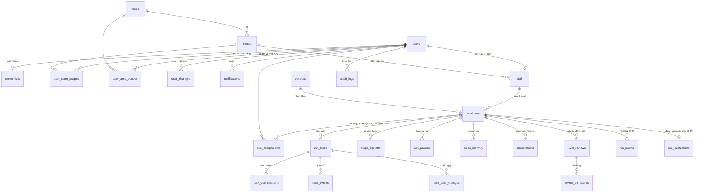

# Cơ sở dữ liệu "Lộ trình Upharma"

Mô tả cơ sở dữ liệu theo mã nguồn hiện tại (commit `596e088`, ngày 2026-10-26). Nguồn gốc của mọi thông tin dưới đây:

| Nội dung | File |
|---|---|
| Định nghĩa bảng (Drizzle ORM) | [apps/api/src/db/schema.ts](../../apps/api/src/db/schema.ts) |
| Migration SQL (chạy theo thứ tự 0000 → 0005) | [apps/api/src/db/migrations/](../../apps/api/src/db/migrations/) |
| Cấu trúc JSONB nội dung phiên bản (Zod) | [packages/shared/src/schemas/version.ts](../../packages/shared/src/schemas/version.ts) |
| Các giá trị liệt kê (vai trò, trạng thái) | [packages/shared/src/roles.ts](../../packages/shared/src/roles.ts), [schedule/state.ts](../../packages/shared/src/schedule/state.ts) |
| Kết nối, chạy migration | [apps/api/src/db/client.ts](../../apps/api/src/db/client.ts) |
| Dữ liệu mẫu | [apps/api/src/db/seed/](../../apps/api/src/db/seed/) |

Khi sửa `schema.ts`, chạy `pnpm db:generate` để sinh migration mới rồi cập nhật lại tài liệu này.

---

## 1. Tổng quan

- **Hệ quản trị:** PostgreSQL (đặc tả ghi 16; máy dev chạy 18; bản demo trên Neon). Một schema `public`, 26 bảng.
- **Truy cập:** Drizzle ORM với `node-postgres`, pool tối đa 10 kết nối.
- **Migration:** chạy tự động mỗi khi API khởi động (`prepareDatabase()` → `runMigrations()`). Drizzle ghi lịch sử migration ở schema `drizzle`.
- **Dữ liệu mẫu:** API tự nạp khi khởi động nếu `DEMO_MODE=true` và cơ sở dữ liệu còn trống; BP ĐT khôi phục lại được ở Quản trị → Cấu hình, công cụ demo.

### Quy ước chung

| Quy ước | Chi tiết |
|---|---|
| Ngày nghiệp vụ | Kiểu `date`, đọc ra nguyên chuỗi `YYYY-MM-DD` (đã tắt chuyển sang `Date` theo múi giờ máy). Dùng cho hạn, ngày bắt đầu Level, ngày tạm dừng… |
| Thời điểm thao tác | Kiểu `timestamptz` (ai làm, lúc nào). |
| "Hôm nay" | Lấy qua `ClockService`: ngày thật, hoặc ngày giả lập lưu ở `system_settings.fake_today` (bản demo). |
| Khóa chính | `serial` (số nguyên tự tăng); riêng `audit_logs` dùng `bigserial`. Bảng phạm vi dùng khóa ghép. |
| Giá trị liệt kê | Lưu dạng `text`, **không** dùng enum hay `CHECK` của PostgreSQL; ứng dụng kiểm tra bằng Zod và kiểu TypeScript (xem mục 5). |
| Khóa ngoại | Mọi khóa ngoại là `ON DELETE NO ACTION`: không có xóa dây chuyền, muốn xóa phải xóa bảng con trước. |
| Xóa dữ liệu | Không xóa vật lý dữ liệu nghiệp vụ (R21): nhân viên nghỉ thì "ngừng theo dõi", xác nhận bị hủy thì đánh dấu `revoked_at`. Ngoại lệ: BP ĐT xóa hẳn hồ sơ tạo nhầm (mục 7.3), bản nháp phiên bản. |
| Chống ghi đè | Cột `row_version` (users, versions, run_tasks, level_reviews): tăng mỗi lần sửa, so khớp khi lưu để hai người sửa cùng lúc không đè nhau. |
| Nội dung phiên bản | Một tài liệu JSONB bất biến trong `versions.content` thay vì nhiều bảng (mục 13.2 đặc tả). |

---

## 2. Sơ đồ quan hệ



Ngoài các quan hệ trên, nhiều bảng có cột "ai làm" (`created_by`, `approved_by`, `entered_by`…) trỏ về `users.id`.

**Luồng chính:** tài khoản (`users`) → hồ sơ nhân viên (`staff`) → mỗi Level là một **lượt** (`level_runs`) chạy theo một phiên bản (`versions`) → lượt sinh ra các **đầu việc** (`run_tasks`) có ngày mở, ngày hạn riêng → người liên quan **xác nhận** (`task_confirmations`) → cuối Level là **phiếu đánh giá** (`level_reviews`) và chuỗi ký.

---

## 3. Các bảng

Ký hiệu: **PK** khóa chính, **FK** khóa ngoại, **UQ** duy nhất. "Bắt buộc" là `NOT NULL`.

### 3.1 Tổ chức và tài khoản

#### `areas` – Khu vực

| Cột | Kiểu | Bắt buộc | Mặc định | Ý nghĩa |
|---|---|---|---|---|
| id | serial | PK | | |
| code | text | ✓, UQ | | Mã khu vực, vd. `HN1` |
| name | text | ✓ | | Tên khu vực |
| active | boolean | ✓ | `true` | Còn dùng hay đã ngừng |

#### `stores` – Cửa hàng / nhà thuốc

| Cột | Kiểu | Bắt buộc | Mặc định | Ý nghĩa |
|---|---|---|---|---|
| id | serial | PK | | |
| code | text | ✓, UQ | | Mã cửa hàng |
| name | text | ✓ | | Tên cửa hàng |
| address | text | | | Địa chỉ |
| area_id | integer | ✓ | | FK → `areas.id` |
| active | boolean | ✓ | `true` | |

#### `users` – Tài khoản đăng nhập

| Cột | Kiểu | Bắt buộc | Mặc định | Ý nghĩa |
|---|---|---|---|---|
| id | serial | PK | | |
| employee_code | text | UQ | | Mã nhân viên |
| full_name | text | ✓ | | Họ tên |
| email | text | ✓, UQ | | Email đăng nhập |
| phone | text | | | |
| role | text | ✓ | | Vai trò tài khoản: `nv`, `cht`, `qlkv`, `bp` |
| status | text | ✓ | `'pending'` | `pending`, `active`, `locked`, `left`, `rejected` |
| can_buddy | boolean | ✓ | `false` | Quyền bổ sung: được làm Buddy |
| can_approve_versions | boolean | ✓ | `false` | Quyền bổ sung: người duyệt phiên bản |
| requested_role | text | | | Vai trò người đăng ký đề nghị (mục 5.1) |
| requested_store_id | integer | | | FK → `stores.id`, nhà thuốc đề nghị |
| requested_area_id | integer | | | FK → `areas.id`, khu vực đề nghị (QLKV) |
| review_note | text | | | Lý do từ chối đăng ký |
| reviewed_by | integer | | | Người duyệt / từ chối (không khai báo FK) |
| reviewed_at | timestamptz | | | |
| row_version | integer | ✓ | `0` | Chống ghi đè |
| last_seen_at | timestamptz | | | Lần vào cuối (dùng cho cảnh báo "không đăng nhập N ngày") |
| created_at | timestamptz | ✓ | `now()` | |

#### `credentials` – Mật khẩu

| Cột | Kiểu | Bắt buộc | Mặc định | Ý nghĩa |
|---|---|---|---|---|
| user_id | integer | PK | | FK → `users.id` (một tài khoản một dòng) |
| password_hash | text | ✓ | | Băm bằng bcrypt |
| password_changed_at | timestamptz | ✓ | `now()` | |

Phiên đăng nhập dùng JWT trong cookie (khóa `JWT_SECRET`), **không** lưu bảng phiên.

#### `user_store_scopes`, `user_area_scopes` – Phạm vi quản lý

| Bảng | Cột | Ý nghĩa |
|---|---|---|
| `user_store_scopes` | user_id (FK → users), store_id (FK → stores); PK (user_id, store_id) | Cửa hàng mà CHT (hoặc NV) phụ trách |
| `user_area_scopes` | user_id (FK → users), area_id (FK → areas); PK (user_id, area_id) | Khu vực mà QLKV phụ trách |

Quyền xem hồ sơ nhân viên tính từ phạm vi này cộng với phân công trên lượt (`run_assignments`).

#### `user_changes` – Lịch sử sửa tài khoản (mục 5.3)

| Cột | Kiểu | Bắt buộc | Ý nghĩa |
|---|---|---|---|
| id | serial | PK | |
| user_id | integer | ✓ | FK → `users.id`, tài khoản bị sửa |
| changed_by | integer | | FK → `users.id`, người sửa |
| field | text | ✓ | Tên trường |
| old_value, new_value | text | | Giá trị cũ, mới |
| at | timestamptz | ✓ | |

Chỉ mục: `user_changes_user_idx (user_id)`.

#### `notifications` – Thông báo trong ứng dụng (mục 10.6)

| Cột | Kiểu | Bắt buộc | Ý nghĩa |
|---|---|---|---|
| id | serial | PK | |
| user_id | integer | ✓ | FK → `users.id`, người nhận |
| type | text | ✓ | Loại thông báo (mục 5) |
| title | text | ✓ | Tiêu đề |
| body | text | | Nội dung |
| link | text | | Đường dẫn trong app, vd. `/nhan-su/12?tab=check` |
| dedupe_key | text | UQ | Khóa chống gửi trùng khi job chạy lại, dạng `<khóa>:<user_id>` |
| business_date | date | ✓ | Ngày nghiệp vụ lúc tạo (theo ngày giả lập) |
| created_at | timestamptz | ✓ | |
| read_at | timestamptz | | Lúc đọc; `null` là chưa đọc |

Chỉ mục: `notifications_user_idx (user_id, read_at)`.

#### `system_settings` – Cấu hình hệ thống

| Cột | Kiểu | Bắt buộc | Ý nghĩa |
|---|---|---|---|
| key | text | PK | Tên cấu hình |
| value | jsonb | ✓ | Giá trị |
| updated_by | integer | | FK → `users.id` |
| updated_at | timestamptz | ✓ | Mặc định `now()` |

Các khóa đang dùng:

| key | value | Ý nghĩa |
|---|---|---|
| `fake_today` | chuỗi `"YYYY-MM-DD"` | Ngày giả lập (bản demo). Không có dòng này là dùng ngày thật |
| `bp_self_publish` | `true` / `false` | Công tắc V20: BP ĐT tự duyệt và ban hành phiên bản (mặc định tắt) |

### 3.2 Phiên bản Bộ lộ trình

#### `versions` – Phiên bản (mục 13.2)

| Cột | Kiểu | Bắt buộc | Mặc định | Ý nghĩa |
|---|---|---|---|---|
| id | serial | PK | | |
| code | text | UQ | | Số phiên bản, vd. `2.1`, `2.2`; cấp khi duyệt, bản nháp chưa có |
| criteria_line | text | | | Dòng tiêu chí = hai số đầu (vd. `2.1`); cấp khi duyệt |
| status | text | ✓ | | `draft`, `pending`, `active`, `expired` |
| effective_from | date | | | Ngày bắt đầu hiệu lực |
| effective_to | date | | | Ngày hết hiệu lực (khi có bản mới thay) |
| parent_id | integer | | | Bản gốc tạo ra bản nháp này (không khai báo FK) |
| change_note | text | | | Ghi chú thay đổi (bắt buộc khi gửi duyệt) |
| change_kind | text | | | `text` (chỉ sửa diễn đạt) hoặc `criteria` (đổi tiêu chí) |
| review_note | text | | | Lý do người duyệt trả về nháp |
| content | jsonb | ✓ | | Toàn bộ nội dung (mục 4) |
| row_version | integer | ✓ | `0` | Chống ghi đè |
| created_by, updated_by, submitted_by, approved_by | integer | | | FK → `users.id` |
| updated_at | timestamptz | ✓ | `now()` | |
| submitted_at, approved_at | timestamptz | | | |
| created_at | timestamptz | ✓ | `now()` | |

**Trạng thái hiển thị** (Nháp, Chờ duyệt, Đang hiệu lực, Sắp hiệu lực, Hết hiệu lực) không lưu mà được tính từ `status` + `effective_from/to` so với "hôm nay".

**Trigger `versions_guard`** (migration 0002, quy tắc R03), chạy trước mỗi `UPDATE` / `DELETE`:
- Chỉ xóa được bản `draft`.
- Bản đã gửi duyệt hoặc ban hành không sửa được `content`.
- Bản đã ban hành (`active`, `expired`) không đưa về nháp được.

Vi phạm sẽ báo lỗi `check_violation` kèm câu giải thích tiếng Việt.

**Thay đổi diễn đạt và thay đổi tiêu chí:** lượt Level lưu `version_id` (bản lúc bắt đầu) và `criteria_line`. Khi hiển thị câu chữ, hệ thống lấy bản **mới nhất đã ban hành của cùng dòng tiêu chí** có hiệu lực tới hôm nay (R02). Vì vậy sửa diễn đạt áp dụng ngay cho NV đang chạy; đổi tiêu chí tạo dòng mới, chỉ áp dụng cho lượt bắt đầu sau ngày hiệu lực.

### 3.3 Nhân viên và lượt Level

#### `staff` – Hồ sơ nhân viên được theo dõi

| Cột | Kiểu | Bắt buộc | Mặc định | Ý nghĩa |
|---|---|---|---|---|
| id | serial | PK | | |
| user_id | integer | UQ | | FK → `users.id`; `null` khi NV chưa có tài khoản |
| employee_code | text | | | Mã NV (không bắt buộc duy nhất) |
| full_name | text | ✓ | | |
| store_id | integer | ✓ | | FK → `stores.id`, cửa hàng hiện tại |
| hire_date | date | ✓ | | Ngày nhận việc |
| current_level | integer | ✓ | `1` | Level hiện tại |
| active | boolean | ✓ | `true` | `false` khi đã ngừng theo dõi |
| stop_reason | text | | | Lý do ngừng theo dõi (nghỉ việc) |
| stopped_at | timestamptz | | | |
| stopped_by | integer | | | FK → `users.id` |
| created_at | timestamptz | ✓ | `now()` | |

#### `level_runs` – Lượt Level (một Level của một nhân viên, hoặc một lượt onboarding CHT)

| Cột | Kiểu | Bắt buộc | Mặc định | Ý nghĩa |
|---|---|---|---|---|
| id | serial | PK | | |
| staff_id | integer | ✓ | | FK → `staff.id` |
| level_key | integer | ✓ | | 1–4; lượt CHT luôn là 1 |
| track | text | ✓ | `'nvbh'` | `nvbh` (lộ trình 4 Level), `cht_moi_tuyen`, `cht_thang_tien` |
| meta | jsonb | ✓ | `{}` | Thông tin riêng lượt CHT: `trainingMode` (`online`/`offline`), `previousStoreName`, `seniorityMonths`, `managerNote` |
| version_id | integer | ✓ | | FK → `versions.id`, bản hiệu lực lúc bắt đầu |
| criteria_line | text | ✓ | | Dòng tiêu chí của bản đó |
| start_date | date | ✓ | | Ngày bắt đầu Level (Ngày D với CHT) |
| planned_end | date | ✓ | | Ngày kết thúc dự kiến (lùi khi tạm dừng, gia hạn) |
| status | text | ✓ | `'active'` | Trạng thái lượt (mục 5) |
| ext_count | integer | ✓ | `0` | Số lần đã gia hạn |
| ack_by | integer | | | FK → `users.id`, người xác nhận đã đọc tổng quan |
| ack_at | timestamptz | | | `null`: NV chưa đọc tổng quan, checklist còn khóa |
| created_by | integer | | | FK → `users.id` |
| created_at | timestamptz | ✓ | `now()` | |

Chỉ mục: `level_runs_staff_idx (staff_id)`. Mỗi nhân viên có nhiều lượt (lịch sử các Level); lượt hiện tại là lượt mới nhất còn mở.

#### `run_assignments` – Phân công trên lượt

| Cột | Kiểu | Bắt buộc | Ý nghĩa |
|---|---|---|---|
| id | serial | PK | |
| run_id | integer | ✓ | FK → `level_runs.id` |
| role | text | ✓ | `buddy`, `cht`, `qlkv`, `trainer` (người phụ trách Đào tạo, lượt CHT) |
| user_id | integer | ✓ | FK → `users.id` |
| from_date | date | ✓ | Ngày bắt đầu phân công |
| to_date | date | | `null`: đang hiệu lực; đổi người thì đóng dòng cũ, thêm dòng mới |

Chỉ mục: `run_assignments_run_idx (run_id)`, `run_assignments_user_idx (user_id)`.

#### `run_pauses` – Tạm dừng lượt (mục 9.3)

| Cột | Kiểu | Bắt buộc | Mặc định | Ý nghĩa |
|---|---|---|---|---|
| id | serial | PK | | |
| run_id | integer | ✓ | | FK → `level_runs.id` |
| from_date, to_date | date | ✓ | | Khoảng nghỉ |
| reason | text | ✓ | | Lý do (nghỉ dài ngày, thai sản…) |
| status | text | ✓ | `'pending'` | `pending`, `approved`, `rejected` |
| requested_by | integer | ✓ | | FK → `users.id` (CHT đề xuất) |
| requested_at | timestamptz | ✓ | | |
| decided_by | integer | | | FK → `users.id` (QLKV hoặc BP ĐT duyệt) |
| decided_at | timestamptz | | | |
| decision_note | text | | | Ghi chú duyệt / lý do từ chối |

Khi duyệt, mọi đầu việc chưa xong từ `from_date` lùi đúng số ngày nghỉ; mỗi lần lùi ghi vào `task_date_changes`.

### 3.4 Đầu việc và xác nhận

#### `run_tasks` – Đầu việc của một lượt

Sinh ra khi tạo lượt, mỗi đầu việc trong checklist của Level là một dòng. **Câu chữ** (nội dung, hướng dẫn, người xác nhận) không chép vào đây mà đọc từ `versions.content` theo `item_key`.

| Cột | Kiểu | Bắt buộc | Mặc định | Ý nghĩa |
|---|---|---|---|---|
| id | serial | PK | | |
| run_id | integer | ✓ | | FK → `level_runs.id` |
| item_key | text | ✓ | | Mã đầu việc trong phiên bản, vd. `L1-3-2`, `CM-1-3` |
| open_date | date | ✓ | | Ngày mở (= ngày bắt đầu giai đoạn) |
| due_date | date | ✓ | | Hạn (= ngày bắt đầu Level + `dueOffset`) |
| status | text | ✓ | `'todo'` | `todo`, `doing`, `help`, `na`, `done`, `void` |
| done_date | date | | | Ngày hoàn thành |
| na_reason | text | | | Lý do bỏ qua (N/A) |
| rework_note | text | | | Lý do yêu cầu làm lại đang chờ xử lý |
| rework_by | integer | | | FK → `users.id` |
| rework_at | timestamptz | | | |
| row_version | integer | ✓ | `0` | Chống ghi đè |
| updated_at | timestamptz | ✓ | `now()` | |

Chỉ mục: `run_tasks_run_item_uq` **duy nhất** (run_id, item_key).

Ngày mở và hạn được **lưu cứng** khi tạo lượt; trạng thái hiển thị (Quá hạn, Hạn hôm nay, Còn N ngày, Sắp mở…) tính lúc đọc bằng `computeTaskState()` theo "hôm nay".

#### `task_confirmations` – Xác nhận đầu việc

| Cột | Kiểu | Bắt buộc | Ý nghĩa |
|---|---|---|---|
| id | serial | PK | |
| task_id | integer | ✓ | FK → `run_tasks.id` |
| role | text | ✓ | Ô xác nhận được điền: `nv` (báo hoàn thành), `buddy`, `cht`, `qlkv`, `bp` |
| user_id | integer | ✓ | FK → `users.id`, người điền |
| proxy_role | text | | Vai trò thật khi xác nhận thay (vd. CHT xác nhận thay Buddy) |
| at | timestamptz | ✓ | |
| note | text | | |
| revoked_at | timestamptz | | Lúc hủy xác nhận; `null` là còn hiệu lực |
| revoked_by | integer | | FK → `users.id` |

Chỉ mục:
- `task_confirmations_active_uq` **duy nhất có điều kiện** (task_id, role) `WHERE revoked_at IS NULL`: mỗi ô chỉ có một xác nhận còn hiệu lực. Hủy xác nhận không xóa dòng mà ghi `revoked_at`.
- `task_confirmations_task_idx (task_id)`.

Đầu việc chuyển `done` khi đủ xác nhận của mọi vai trò yêu cầu (NV + `verifiers` trong phiên bản).

#### `task_events` – Lịch sử thao tác trên đầu việc

| Cột | Kiểu | Bắt buộc | Ý nghĩa |
|---|---|---|---|
| id | serial | PK | |
| task_id | integer | ✓ | FK → `run_tasks.id` |
| user_id | integer | ✓ | FK → `users.id` |
| role, proxy_role | text | | Vai trò, vai trò xác nhận thay |
| action | text | ✓ | `report_done`, `confirm`, `undo`, `rework`, `help`, `clear_help`, `na`, `set_doing`, `set_todo` |
| note | text | | |
| at | timestamptz | ✓ | |

Chỉ mục: `task_events_task_idx (task_id)`.

#### `task_date_changes` – Nhật ký đổi ngày đầu việc (R18)

| Cột | Kiểu | Bắt buộc | Ý nghĩa |
|---|---|---|---|
| id | serial | PK | |
| task_id | integer | ✓ | FK → `run_tasks.id` |
| old_open, old_due, new_open, new_due | date | ✓ | Ngày cũ và mới |
| reason | text | ✓ | `pause` (tạm dừng), `extend` (gia hạn), `migrate` (chuyển phiên bản) |
| ref_id | integer | | Mã bản ghi gây ra thay đổi, vd. `run_pauses.id` (không khai báo FK) |
| at | timestamptz | ✓ | |
| by | integer | | FK → `users.id` |

Chỉ mục: `task_date_changes_task_idx (task_id)`.

#### `stage_signoffs` – Ký cuối giai đoạn (R11, R12)

| Cột | Kiểu | Bắt buộc | Ý nghĩa |
|---|---|---|---|
| id | serial | PK | |
| run_id | integer | ✓ | FK → `level_runs.id` |
| stage_key | text | ✓ | Mã giai đoạn trong phiên bản |
| step | integer | ✓ | Thứ tự trong chuỗi ký (`stage.signers` của phiên bản) |
| role | text | ✓ | Vai trò ký |
| user_id | integer | ✓ | FK → `users.id` |
| at | timestamptz | ✓ | |

Chỉ mục: `stage_signoffs_step_uq` **duy nhất** (run_id, stage_key, step).

### 3.5 Đánh giá và chuyển Level (mục 11.5)

#### `sales_monthly` – Doanh số theo tháng của Level

| Cột | Kiểu | Bắt buộc | Mặc định | Ý nghĩa |
|---|---|---|---|---|
| id | serial | PK | | |
| run_id | integer | ✓ | | FK → `level_runs.id` |
| month_index | integer | ✓ | | Tháng thứ mấy của Level (1, 2, …) |
| total | double precision | | | Doanh số tổng, triệu đồng |
| coef1 | double precision | | | Doanh số hàng hệ số 1, triệu đồng |
| source | text | ✓ | `'manual'` | `manual` (nhập tay) hoặc `pos` (dự phòng cho tích hợp POS, hiện chưa dùng) |
| entered_by | integer | | | FK → `users.id` |
| at | timestamptz | ✓ | `now()` | |

Chỉ mục: `sales_monthly_run_month_uq` **duy nhất** (run_id, month_index).

#### `observations` – Ca quan sát Rubric (Phụ lục C)

| Cột | Kiểu | Bắt buộc | Ý nghĩa |
|---|---|---|---|
| id | serial | PK | |
| run_id | integer | ✓ | FK → `level_runs.id` |
| obs_date | date | ✓ | Ngày quan sát |
| scores | jsonb | ✓ | Điểm theo mã tiêu chí Rubric, vd. `{"c1": 3, "c2": 2}` |
| note | text | | Nhận xét |
| observer_id | integer | ✓ | FK → `users.id` |
| created_at | timestamptz | ✓ | Mặc định `now()` |

Chỉ mục: `observations_run_idx (run_id)`. Đạt hay không tính lúc đọc theo `rubric` trong phiên bản (`passTotal`, `forbidOne`).

#### `level_reviews` – Phiếu đánh giá tổng kết

Mỗi vòng gia hạn là một phiếu mới (`round` tăng dần).

| Cột | Kiểu | Bắt buộc | Mặc định | Ý nghĩa |
|---|---|---|---|---|
| id | serial | PK | | |
| run_id | integer | ✓ | | FK → `level_runs.id` |
| round | integer | ✓ | `0` | 0: phiếu đầu; 1, 2…: các vòng gia hạn |
| criteria_results | jsonb | ✓ | `[]` | Mảng kết quả từng tiêu chí: `''`, `'pass'`, `'fail'` (theo thứ tự `reviewCriteria`) |
| notes | jsonb | ✓ | `{}` | Nhận xét theo mã câu hỏi (`review.prompts[].key`) |
| result | text | | | Kết quả đề xuất: `pass`, `extend`, `fail` |
| ext_goals | text | ✓ | `''` | Mục tiêu trong thời gian gia hạn, mỗi dòng một mục |
| status | text | ✓ | `'draft'` | `draft` (đang điền), `signing` (đang ký), `done` (đã ký đủ) |
| saved_by | integer | | | FK → `users.id` |
| saved_at | timestamptz | | | |
| applied_at | timestamptz | | | Lúc kết quả được áp dụng (chuyển Level, gia hạn, đóng lượt) |
| row_version | integer | ✓ | `0` | |
| created_at | timestamptz | ✓ | `now()` | |

Chỉ mục: `level_reviews_run_round_uq` **duy nhất** (run_id, round).

#### `review_signatures` – Chuỗi ký phiếu đánh giá (R12)

| Cột | Kiểu | Bắt buộc | Ý nghĩa |
|---|---|---|---|
| id | serial | PK | |
| review_id | integer | ✓ | FK → `level_reviews.id` |
| step | integer | ✓ | Thứ tự ký (`review.signers` của phiên bản) |
| role | text | ✓ | Vai trò ký |
| user_id | integer | ✓ | FK → `users.id` |
| at | timestamptz | ✓ | |

Chỉ mục: `review_signatures_step_uq` **duy nhất** (review_id, step).

### 3.6 Onboarding Cửa hàng trưởng

#### `run_journal` – Nhật ký theo dõi hằng ngày

| Cột | Kiểu | Bắt buộc | Mặc định | Ý nghĩa |
|---|---|---|---|---|
| id | serial | PK | | |
| run_id | integer | ✓ | | FK → `level_runs.id` (lượt CHT) |
| day | integer | ✓ | | 0 là Ngày D, 1 là D+1… |
| mood | text | | | Cảm xúc CHT (chọn từ `moods` của checklist CHT) |
| difficulties | text | ✓ | `''` | Khó khăn |
| actions | text | ✓ | `''` | Hành động hỗ trợ |
| manager_note | text | ✓ | `''` | Ghi chú của quản lý |
| updated_by, manager_by | integer | | | FK → `users.id` |
| updated_at, manager_at | timestamptz | | | |

Chỉ mục: `run_journal_run_day_uq` **duy nhất** (run_id, day).

#### `run_evaluations` – Đánh giá tổng kết tuần đầu

| Cột | Kiểu | Bắt buộc | Mặc định | Ý nghĩa |
|---|---|---|---|---|
| id | serial | PK | | |
| run_id | integer | ✓, UQ | | FK → `level_runs.id` (mỗi lượt CHT một phiếu) |
| ratings | jsonb | ✓ | `{}` | Điểm sao 1–5 theo mã tiêu chí (`ratings` của checklist CHT) |
| risk | text | | | Nguy cơ nghỉ việc: `low`, `medium`, `high` |
| suggestion | text | ✓ | `''` | Đề xuất hỗ trợ tuần 2 |
| saved_by | integer | | | FK → `users.id` |
| saved_at | timestamptz | | | |
| confirmed_by | integer | | | FK → `users.id` (QLKV xác nhận) |
| confirmed_at | timestamptz | | | Có giá trị thì lượt CHT chuyển `passed` |
| confirm_note | text | | | |

### 3.7 Nhật ký hệ thống

#### `audit_logs` (mục 5.7)

| Cột | Kiểu | Bắt buộc | Ý nghĩa |
|---|---|---|---|
| id | bigserial | PK | |
| user_id | integer | | FK → `users.id`; `null` với thao tác của hệ thống |
| action | text | ✓ | Dạng `METHOD /đường-dẫn` (vd. `POST /api/v1/tasks/:id/confirm`) hoặc tên sự kiện (`auth.login`, `auth.login_demo`, `auth.register`, `demo.reset`) |
| entity | text | | Loại đối tượng |
| entity_id | text | | Mã đối tượng |
| payload | jsonb | | Dữ liệu gửi lên / chi tiết |
| at | timestamptz | ✓ | Thời điểm thật của máy chủ (không theo ngày giả lập) |
| ip | text | | IP người dùng |

Ghi tự động cho mọi yêu cầu ghi dữ liệu (không phải GET) thành công, trừ đánh dấu đã đọc thông báo; trường mật khẩu được bỏ khỏi `payload`. Đăng nhập, đăng ký, khôi phục dữ liệu mẫu ghi riêng theo tên sự kiện. Chỉ BP ĐT xem; không sửa, không xóa. Nhãn tiếng Việt cho `action` nằm ở [audit.controller.ts](../../apps/api/src/modules/audit/audit.controller.ts).

---

## 4. Nội dung phiên bản (`versions.content`, JSONB)

Kiểm tra bằng `VersionContentSchema` (Zod). Mốc thời gian là **số ngày tính từ ngày bắt đầu Level**.

```text
content
├─ levels[4]                      Level 1..4 (key phải đúng 1, 2, 3, 4)
│  ├─ key, name, phase, motto, durationLabel, rangeLabel, months, totalDays, checklistName
│  ├─ kpi { total, coef1, ratio, method?: all_months|average, windowFrom?, windowTo? }   (triệu đồng, %)
│  ├─ overview { goals[{title, body}], kpiTable[][], responsibilities[{heading, items[]}], lms[], counter[], note? }
│  ├─ reviewCriteria[{ name, threshold, source }]            phần A phiếu đánh giá
│  ├─ review? { flow, when, prompts[{key, text, minPoints}], passLabel, allowFail,
│  │            extension{enabled, months, maxTimes, maxGoals}, signers[] }
│  └─ stages[]                    giai đoạn
│     ├─ key, order, name, label, offsetStart, offsetEnd, shiftFrom?, shiftTo?, goal
│     ├─ signers[]                chuỗi ký cuối giai đoạn (mặc định ["cht"])
│     └─ items[]                  đầu việc
│        ├─ key                   mã cố định qua các phiên bản: L{level}-{giai đoạn}-{thứ tự}
│        ├─ order, category, content, guidance
│        ├─ verifiers[]           vai trò xác nhận ngoài NV: buddy, cht, qlkv, bp; rỗng = NV tự đánh giá
│        ├─ requireNvFirst        có phần NV xác nhận, NV báo xong trước (mặc định true)
│        ├─ dueOffset             hạn = ngày bắt đầu Level + dueOffset
│        ├─ gpp, required, allowNa
│        ├─ dataSource            manual | lms | pos   (đang ẩn trên giao diện, giữ trong dữ liệu)
│        ├─ evidence              none | score | note | file   (đang ẩn)
│        ├─ dependsOn[]           mã đầu việc phải xong trước
│        └─ sourceRef?, session? (sang|chieu|cuoi_ngay), supporter?, link?
├─ scheduleParams                 tham số lịch (mục 10.4)
│  └─ remindDays 3, escalateDays 7, signOpenBefore 3, signDueAfter 3, posDataDay 5,
│     exemptFromDay 15, upcomingDays 14, graceDays 14, shiftsPerWeek 6   (giá trị mặc định)
├─ rubric?                        Rubric quan sát, dùng chung mọi Level
│  └─ scaleMax, passTotal, forbidOne, minObsPerMonth, targetRate, criteria[{key, name, d1, d2, d3, critical}]
├─ framework?                     phần giới thiệu Khung năng lực
│  └─ intro[], levelTable[][], responsibilityTable[][], kpiTable[][]
└─ chtTracks?[]                   checklist onboarding CHT (tối đa mỗi loại một)
   └─ key (cht_moi_tuyen|cht_thang_tien), code (tiền tố mã, 2–4 chữ in hoa), name, title, goal, tip,
      notes[], totalDays, moods[], ratings[{key, label}], stages[] (cấu trúc như stages ở trên)
```

Schema chỉ kiểm tra cấu trúc để bản nháp soạn dở vẫn lưu được. Quy tắc nghiệp vụ (CK-01…CK-11, KNL-…) nằm ở `packages/shared/src/validation/` và chặn ở bước gửi duyệt, ban hành.

---

## 5. Giá trị liệt kê

| Cột | Giá trị |
|---|---|
| `users.role`, `users.requested_role` | `nv` Nhân viên · `cht` Cửa hàng trưởng · `qlkv` QLKV · `bp` BP Đào tạo |
| `users.status` | `pending` Chờ duyệt · `active` Hoạt động · `locked` Tạm khóa · `left` Đã nghỉ · `rejected` Bị từ chối |
| Vai trò trên đầu việc (`task_confirmations.role`, `stage_signoffs.role`, `review_signatures.role`…) | `nv`, `buddy`, `cht`, `qlkv`, `bp` (Buddy là vai trò phân công, không phải vai trò tài khoản) |
| `run_assignments.role` | `buddy`, `cht`, `qlkv`, `trainer` |
| `level_runs.track` | `nvbh`, `cht_moi_tuyen`, `cht_thang_tien` |
| `level_runs.status` | `active` Đang chạy · `paused` Tạm dừng · `review` Chờ đánh giá · `passed` Đạt · `extended` Gia hạn · `failed` Không đạt · `stopped` Dừng · `promoted` Thăng chức CHT |
| `run_tasks.status` | `todo` Chưa bắt đầu · `doing` Đang thực hiện · `help` Cần hỗ trợ · `na` Bỏ qua / N-A · `done` Đã hoàn thành · `void` Không áp dụng do đổi phiên bản |
| `task_events.action` | `report_done`, `confirm`, `undo`, `rework`, `help`, `clear_help`, `na`, `set_doing`, `set_todo` |
| `task_date_changes.reason` | `pause`, `extend`, `migrate` |
| `run_pauses.status` | `pending`, `approved`, `rejected` |
| `versions.status` | `draft`, `pending`, `active`, `expired` |
| `versions.change_kind` | `text`, `criteria` |
| `level_reviews.status` | `draft`, `signing`, `done` |
| `level_reviews.result` | `pass`, `extend`, `fail` |
| `sales_monthly.source` | `manual`, `pos` |
| `run_evaluations.risk` | `low`, `medium`, `high` |
| `notifications.type` | `digest` bản tin sáng · `report_done` chờ xác nhận · `help` cần hỗ trợ · `rework` làm lại · `stage_sign` ký giai đoạn · `review_sign` ký phiếu · `escalation` leo thang · `run_start` sắp bắt đầu · `pause`, `pause_request` tạm dừng · `assignment` phân công · `transfer` chuyển cửa hàng · `registration` đăng ký mới · `account` tài khoản · `version_pending`, `version_returned`, `version_active`, `version_rescheduled` phiên bản |

---

## 6. Ràng buộc duy nhất và chỉ mục

| Bảng | Tên | Loại | Cột |
|---|---|---|---|
| areas, stores | (tự sinh) | UQ | code |
| users | (tự sinh) | UQ | email; employee_code |
| staff | (tự sinh) | UQ | user_id |
| versions | (tự sinh) | UQ | code |
| notifications | (tự sinh) | UQ | dedupe_key |
| run_evaluations | (tự sinh) | UQ | run_id |
| run_tasks | run_tasks_run_item_uq | UQ | run_id, item_key |
| task_confirmations | task_confirmations_active_uq | UQ có điều kiện | task_id, role `WHERE revoked_at IS NULL` |
| stage_signoffs | stage_signoffs_step_uq | UQ | run_id, stage_key, step |
| sales_monthly | sales_monthly_run_month_uq | UQ | run_id, month_index |
| level_reviews | level_reviews_run_round_uq | UQ | run_id, round |
| review_signatures | review_signatures_step_uq | UQ | review_id, step |
| run_journal | run_journal_run_day_uq | UQ | run_id, day |
| level_runs | level_runs_staff_idx | index | staff_id |
| run_assignments | run_assignments_run_idx, run_assignments_user_idx | index | run_id; user_id |
| task_confirmations | task_confirmations_task_idx | index | task_id |
| task_events | task_events_task_idx | index | task_id |
| task_date_changes | task_date_changes_task_idx | index | task_id |
| run_pauses | run_pauses_run_idx | index | run_id |
| observations | observations_run_idx | index | run_id |
| notifications | notifications_user_idx | index | user_id, read_at |
| user_changes | user_changes_user_idx | index | user_id |

---

## 7. Vòng đời dữ liệu chính

### 7.1 Tạo lượt Level

Khi thêm nhân viên hoặc chuyển Level, trong một transaction:
1. Lấy phiên bản đang hiệu lực tại ngày bắt đầu (R01).
2. Thêm `level_runs` với `version_id`, `criteria_line`, `start_date`, `planned_end = start_date + totalDays`.
3. Thêm `run_assignments` cho Buddy, CHT, QLKV (lượt CHT: người phụ trách Đào tạo, QLKV, Buddy).
4. Sinh `run_tasks` cho mọi đầu việc của Level, tính sẵn `open_date`, `due_date`.

### 7.2 Xác nhận đầu việc

NV báo xong → thêm `task_confirmations` (role `nv`) và `task_events` (`report_done`). Người xác nhận điền ô của mình → thêm `task_confirmations`. Đủ mọi ô thì `run_tasks.status = 'done'`. Hủy xác nhận → ghi `revoked_at`, không xóa dòng. Mọi thao tác đều thêm một dòng `task_events`.

### 7.3 Ngừng theo dõi và xóa hồ sơ

- **Ngừng theo dõi** (nhân viên nghỉ việc): `staff.active = false`, ghi `stop_reason`; lượt chuyển `stopped`; dữ liệu giữ nguyên.
- **Xóa hẳn hồ sơ** (chỉ BP ĐT, hồ sơ tạo nhầm): do không có xóa dây chuyền, ứng dụng xóa theo thứ tự:
  1. `task_confirmations`, `task_events`, `task_date_changes`, `review_signatures`.
  2. Các bảng theo lượt: `run_tasks`, `run_assignments`, `stage_signoffs`, `run_pauses`, `sales_monthly`, `observations`, `level_reviews`, `run_journal`, `run_evaluations`.
  3. `level_runs`.
  4. `notifications` trỏ tới hồ sơ.
  5. `staff`.

  Tài khoản `users` giữ nguyên; `audit_logs` ghi họ tên và lý do.

### 7.4 Phiên bản

Tạo nháp (sao `content` từ bản gốc, `parent_id`) → sửa nháp → gửi duyệt (`pending`, trigger khóa `content`) → duyệt và ban hành (`active`, cấp `code`, `criteria_line`, `effective_from`; bản cũ được đặt `effective_to`) hoặc trả về nháp (`review_note`).

---

## 8. Lệnh làm việc với cơ sở dữ liệu

Chạy ở thư mục gốc dự án; kết nối lấy từ `DATABASE_URL` trong `.env`.

| Lệnh | Việc làm |
|---|---|
| `pnpm db:migrate` | Chạy các migration chưa chạy |
| `pnpm db:seed` | Nạp dữ liệu mẫu (phiên bản v2.1, tài khoản demo, nhân viên và lượt mẫu) |
| `pnpm db:reset` | Xóa sạch schema `public` và `drizzle`, chạy lại migration và dữ liệu mẫu |
| `pnpm db:generate` | Sinh migration mới từ thay đổi trong `schema.ts` (drizzle-kit) |

Tạo cơ sở dữ liệu và người dùng PostgreSQL lần đầu: [scripts/setup-db.sql](../../scripts/setup-db.sql).
