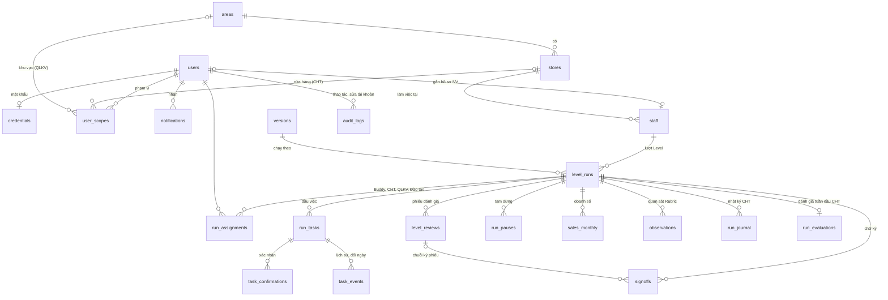

# Cơ sở dữ liệu "Lộ trình Upharma"

Mô tả cơ sở dữ liệu theo mã nguồn ngày 2026-11-10, nhánh `sqlserver`. Nguồn gốc của mọi thông tin dưới đây:

| Nội dung | File |
|---|---|
| Định nghĩa bảng (Drizzle ORM, `mssql-core`) | [apps/api/src/db/schema.ts](../../apps/api/src/db/schema.ts) |
| Migration SQL, **nguồn chuẩn**. Chạy theo thứ tự thời điểm: `20261110032531_khoi_tao` (sinh từ schema), `20261110032542_trigger_phien_ban` (viết tay, trigger của `versions`) | [apps/api/src/db/migrations/](../../apps/api/src/db/migrations/) |
| Script tạo bảng tham khảo, để đọc (tên ràng buộc có thể khác migration) | [docs/thiet-ke/sqlserver/01_tao_bang.sql](sqlserver/01_tao_bang.sql) |
| Khác biệt PostgreSQL → SQL Server, kết quả thử Drizzle | [docs/thiet-ke/sqlserver/KET_QUA_THU_DRIZZLE.md](sqlserver/KET_QUA_THU_DRIZZLE.md) |
| Cấu trúc JSON nội dung phiên bản (Zod) | [packages/shared/src/schemas/version.ts](../../packages/shared/src/schemas/version.ts) |
| Các giá trị liệt kê (vai trò, trạng thái) | [packages/shared/src/roles.ts](../../packages/shared/src/roles.ts), [schedule/state.ts](../../packages/shared/src/schedule/state.ts); trạng thái lượt, phiên bản, tạm dừng khai báo trong `schema.ts` |
| Kết nối, chạy migration, xóa sạch | [apps/api/src/db/client.ts](../../apps/api/src/db/client.ts) |
| Mẫu thay tính năng PostgreSQL (khóa dòng, upsert, chia lô) | [apps/api/src/db/mssql.ts](../../apps/api/src/db/mssql.ts) |
| Phạm vi dữ liệu, lịch sử sửa tài khoản | [apps/api/src/db/scopes.ts](../../apps/api/src/db/scopes.ts), [modules/audit/user-changes.ts](../../apps/api/src/modules/audit/user-changes.ts) |
| Nguồn "hôm nay" | [apps/api/src/adapters/clock/clock.service.ts](../../apps/api/src/adapters/clock/clock.service.ts) |
| Tạo cơ sở dữ liệu, tài khoản ứng dụng | [scripts/setup-sqlserver.sql](../../scripts/setup-sqlserver.sql) |
| Dữ liệu mẫu | [apps/api/src/db/seed/](../../apps/api/src/db/seed/) |

Khi sửa `schema.ts`, chạy `pnpm db:generate` để sinh migration mới rồi cập nhật lại tài liệu này.

---

## 1. Tổng quan

- **Hệ quản trị:** SQL Server 2022 (đã thử bản Developer 16.0.4305.5, cài trực tiếp trên Ubuntu 22.04, không Docker). Cần tối thiểu SQL Server 2016 vì dùng `ISJSON`. Chỉ chạy trên máy cá nhân.
- **Cơ sở dữ liệu:** `lotrinh` (chạy thử) và `lotrinh_test` (test API, bị xóa sạch mỗi lần chạy test). Cả hai dùng collation `Vietnamese_100_CI_AS` (so sánh chuỗi không phân biệt hoa thường, có phân biệt dấu) và bật `READ_COMMITTED_SNAPSHOT` (người đọc không bị chặn khi có người đang ghi). Ứng dụng kết nối bằng tài khoản `lotrinh_app` (`db_owner`).
- **Schema:** mọi bảng nằm trong schema `lotrinh`, 21 bảng.
- **Truy cập:** Drizzle ORM 1.0.0-rc.5 (`drizzle-orm/node-mssql`) với driver `mssql` 11.0.2. Chuỗi kết nối đặt ở `DATABASE_URL`, dạng `Server=localhost,1433;Database=lotrinh;User Id=...;Password=...;Encrypt=true;TrustServerCertificate=true`.
- **Migration:** chạy tự động mỗi khi API khởi động (`prepareDatabase()` → `runMigrations()`). Mỗi migration là một thư mục `<thời điểm>_<tên>/` gồm `migration.sql` và `snapshot.json`. Drizzle ghi lịch sử ở bảng `drizzle.__drizzle_migrations` (schema `drizzle`).
- **Dữ liệu mẫu:** API tự nạp khi khởi động nếu `DEMO_MODE=true` và cơ sở dữ liệu còn trống; BP ĐT khôi phục lại được ở Quản trị → Công cụ demo. Dữ liệu mẫu dựng lùi từ hôm nay thật.

**So với bản PostgreSQL (26 bảng)**, đã gom còn 21 bảng:

| Bản PostgreSQL | Nay |
|---|---|
| `user_changes` | `audit_logs` với `action = 'user.change'` (mục 3.7) |
| `task_date_changes` | `task_events` với `action = 'date_change'`, chi tiết ở cột `data` (mục 3.4) |
| `user_store_scopes`, `user_area_scopes` | `user_scopes` (mục 3.1) |
| `stage_signoffs`, `review_signatures` | `signoffs` (mục 3.5) |
| `system_settings` | Bỏ. Bảng chỉ lưu ngày giả lập của đồng hồ demo, nay đã bỏ |
| Cột `level_runs.criteria_line` | Bỏ. Dòng tiêu chí lấy từ `versions.criteria_line` theo `version_id` |

Bảng `credentials` giữ lại tới khi tích hợp SSO.

### Quy ước chung

| Quy ước | Chi tiết |
|---|---|
| Ngày nghiệp vụ | Kiểu `date`, đọc ra nguyên chuỗi `YYYY-MM-DD` (khai báo `mode: 'string'` trong schema), không chuyển sang `Date`. Dùng cho hạn, ngày bắt đầu Level, ngày tạm dừng… |
| Thời điểm thao tác | Kiểu `datetimeoffset(3)`: kèm múi giờ, chính xác tới mili giây (ai làm, lúc nào). Cột có mặc định dùng `SYSDATETIMEOFFSET()`; không dùng `GETDATE()` vì không có múi giờ, bị coi là +00:00. |
| "Hôm nay" | Lấy qua `ClockService`: luôn là ngày thật theo múi giờ `TZ` (mặc định `Asia/Ho_Chi_Minh`). Không còn ngày giả lập; test thay bằng đồng hồ giả. |
| Chữ | `nvarchar(n)` có độ dài tối đa cho chuỗi ngắn, `nvarchar(max)` cho văn bản dài. Luôn dùng `nvarchar` để lưu tiếng Việt. |
| JSON | Lưu trong `nvarchar(max)` kèm CHECK `ISJSON(...) = 1`. Drizzle tự chuyển giữa chuỗi và đối tượng. |
| Kiểu khác | Đúng/sai: `bit` (1/0). Số thực: `float`. |
| Khóa chính | `int identity` (số nguyên tự tăng); riêng `audit_logs` dùng `bigint identity`, `credentials` dùng `user_id`. |
| Giá trị liệt kê | Lưu dạng `nvarchar`, có CHECK `IN (...)` cho mọi cột trạng thái và vai trò (mục 5, 6.2). Danh sách trong CHECK sinh từ cùng hằng TypeScript mà Zod dùng. CHECK cho qua `NULL` ở cột không bắt buộc. Không có CHECK: `notifications.type`, `task_events.action`, `audit_logs.action`. |
| Giá trị mặc định | drizzle-kit sinh chuỗi mặc định không có tiền tố `N` (vd. `'pending'`). Giá trị không dấu thì không sao; giá trị có dấu phải viết `` sql`N'...'` ``. |
| Khóa ngoại | Mọi khóa ngoại là `NO ACTION`: không có xóa dây chuyền, muốn xóa phải xóa bảng con trước. |
| Xóa dữ liệu | Không xóa vật lý dữ liệu nghiệp vụ (R21): nhân viên nghỉ thì "ngừng theo dõi", xác nhận bị hủy thì đánh dấu `revoked_at`. Ngoại lệ: BP ĐT xóa hẳn hồ sơ tạo nhầm (mục 7.3), bản nháp phiên bản, phân công chưa có hiệu lực khi đổi người (mục 7.5), phạm vi tài khoản khi sửa (thay toàn bộ). |
| Chống ghi đè | Cột `row_version` (users, versions, run_tasks, level_reviews): tăng mỗi lần sửa, so khớp khi lưu để hai người sửa cùng lúc không đè nhau. |
| Ghi đồng thời | SQL Server không có `SELECT ... FOR UPDATE`, `ON CONFLICT`. Dùng các hàm trong `mssql.ts` (mục 6.4). |
| Nội dung phiên bản | Một tài liệu JSON bất biến trong `versions.content` thay vì nhiều bảng (mục 13.2 đặc tả). |

---

## 2. Sơ đồ quan hệ



Ngoài các quan hệ trên, nhiều bảng có cột "ai làm" (`created_by`, `approved_by`, `entered_by`…) trỏ về `users.id`. Lịch sử sửa tài khoản nằm trong `audit_logs`: `user_id` là người sửa, tài khoản bị sửa ghi ở `entity_id` (không có khóa ngoại).

**Luồng chính:** tài khoản (`users`) → hồ sơ nhân viên (`staff`) → mỗi Level là một **lượt** (`level_runs`) chạy theo một phiên bản (`versions`) → lượt sinh ra các **đầu việc** (`run_tasks`) có ngày mở, ngày hạn riêng → người liên quan **xác nhận** (`task_confirmations`) → cuối giai đoạn và cuối Level là **chuỗi ký** (`signoffs`) cùng **phiếu đánh giá** (`level_reviews`).

---

## 3. Các bảng

Ký hiệu: **PK** khóa chính, **FK** khóa ngoại, **UQ** duy nhất. Với cột để trống được, UQ là filtered unique index `WHERE cột IS NOT NULL`: nhiều dòng để trống không vi phạm, đã có giá trị thì không trùng. "Bắt buộc" là `NOT NULL`. "CHECK" ở cột Ý nghĩa là có ràng buộc kiểm tra; tên và điều kiện ở mục 6.2.

### 3.1 Tổ chức và tài khoản

#### `areas` – Khu vực

| Cột | Kiểu | Bắt buộc | Mặc định | Ý nghĩa |
|---|---|---|---|---|
| id | int identity | PK | | |
| code | nvarchar(50) | ✓, UQ | | Mã khu vực, vd. `HN1` |
| name | nvarchar(200) | ✓ | | Tên khu vực |
| active | bit | ✓ | `1` | Còn dùng hay đã ngừng |

#### `stores` – Cửa hàng / nhà thuốc

| Cột | Kiểu | Bắt buộc | Mặc định | Ý nghĩa |
|---|---|---|---|---|
| id | int identity | PK | | |
| code | nvarchar(50) | ✓, UQ | | Mã cửa hàng |
| name | nvarchar(200) | ✓ | | Tên cửa hàng |
| address | nvarchar(500) | | | Địa chỉ |
| area_id | int | ✓ | | FK → `areas.id` |
| active | bit | ✓ | `1` | |

#### `users` – Tài khoản đăng nhập

| Cột | Kiểu | Bắt buộc | Mặc định | Ý nghĩa |
|---|---|---|---|---|
| id | int identity | PK | | |
| employee_code | nvarchar(30) | UQ | | Mã nhân viên |
| full_name | nvarchar(200) | ✓ | | Họ tên |
| email | nvarchar(255) | ✓, UQ | | Email đăng nhập (tên đăng nhập tới khi chuyển sang SSO) |
| phone | nvarchar(30) | | | |
| role | nvarchar(10) | ✓ | | Vai trò tài khoản: `nv`, `cht`, `qlkv`, `bp` (CHECK) |
| status | nvarchar(10) | ✓ | `'pending'` | `pending`, `active`, `locked`, `left`, `rejected` (CHECK) |
| can_buddy | bit | ✓ | `0` | Quyền bổ sung: được làm Buddy |
| requested_role | nvarchar(10) | | | Vai trò người đăng ký đề nghị (mục 5.1); cùng danh sách với `role` (CHECK) |
| requested_store_id | int | | | FK → `stores.id`, nhà thuốc đề nghị |
| requested_area_id | int | | | FK → `areas.id`, khu vực đề nghị (QLKV) |
| review_note | nvarchar(max) | | | Lý do từ chối đăng ký |
| reviewed_by | int | | | Người duyệt / từ chối (không khai báo FK) |
| reviewed_at | datetimeoffset(3) | | | |
| row_version | int | ✓ | `0` | Chống ghi đè |
| last_seen_at | datetimeoffset(3) | | | Lần vào cuối (dùng cho cảnh báo "không đăng nhập N ngày") |
| created_at | datetimeoffset(3) | ✓ | `SYSDATETIMEOFFSET()` | |

Lịch sử sửa tài khoản (mục 5.3) ghi vào `audit_logs` (mục 3.7).

#### `credentials` – Mật khẩu

| Cột | Kiểu | Bắt buộc | Mặc định | Ý nghĩa |
|---|---|---|---|---|
| user_id | int | PK | | FK → `users.id` (một tài khoản một dòng) |
| password_hash | nvarchar(200) | ✓ | | Băm bằng bcrypt |
| password_changed_at | datetimeoffset(3) | ✓ | `SYSDATETIMEOFFSET()` | |

Mật khẩu đăng nhập nội bộ; bỏ bảng này khi chuyển sang SSO. Phiên đăng nhập dùng JWT trong cookie (khóa `JWT_SECRET`), **không** lưu bảng phiên.

#### `user_scopes` – Phạm vi quản lý

Gom hai bảng cũ `user_store_scopes` và `user_area_scopes`. Mỗi dòng là một cửa hàng hoặc một khu vực mà tài khoản phụ trách.

| Cột | Kiểu | Bắt buộc | Ý nghĩa |
|---|---|---|---|
| id | int identity | PK | |
| user_id | int | ✓ | FK → `users.id` |
| store_id | int | | FK → `stores.id`, cửa hàng mà CHT phụ trách |
| area_id | int | | FK → `areas.id`, khu vực mà QLKV phụ trách |

Ràng buộc:
- `user_scopes_one_of` (CHECK): mỗi dòng có **đúng một** trong `store_id`, `area_id`.
- `user_scopes_store_uq` **duy nhất có điều kiện** (user_id, store_id) `WHERE store_id IS NOT NULL`.
- `user_scopes_area_uq` **duy nhất có điều kiện** (user_id, area_id) `WHERE area_id IS NOT NULL`.

Đọc qua `storeScopeRows()`, `areaScopeRows()` ([scopes.ts](../../apps/api/src/db/scopes.ts)): nối sang `stores` hoặc `areas` nên chỉ lấy đúng loại. Sửa bằng `replaceScopes()`: xóa toàn bộ phạm vi của tài khoản rồi thêm lại.

Quyền xem hồ sơ nhân viên tính từ phạm vi này cộng với phân công trên lượt (`run_assignments`).

#### `notifications` – Thông báo trong ứng dụng (mục 10.6)

| Cột | Kiểu | Bắt buộc | Ý nghĩa |
|---|---|---|---|
| id | int identity | PK | |
| user_id | int | ✓ | FK → `users.id`, người nhận |
| type | nvarchar(50) | ✓ | Loại thông báo (mục 5); không có CHECK |
| title | nvarchar(300) | ✓ | Tiêu đề |
| body | nvarchar(max) | | Nội dung |
| link | nvarchar(500) | | Đường dẫn trong app, vd. `/nhan-su/12?tab=check` |
| dedupe_key | nvarchar(200) | UQ | Khóa chống gửi trùng khi job chạy lại, dạng `<khóa>:<user_id>` |
| business_date | date | ✓ | Ngày nghiệp vụ lúc tạo ("hôm nay" của `ClockService`) |
| created_at | datetimeoffset(3) | ✓ | |
| read_at | datetimeoffset(3) | | Lúc đọc; `null` là chưa đọc |

Chỉ mục: `notifications_user_idx (user_id, read_at)`; `notifications_dedupe_uq` **duy nhất có điều kiện** (dedupe_key) `WHERE dedupe_key IS NOT NULL`. Ghi từng dòng bằng `insertIgnore()`: trùng `dedupe_key` thì bỏ qua người đó.

### 3.2 Phiên bản Bộ lộ trình

#### `versions` – Phiên bản (mục 13.2)

| Cột | Kiểu | Bắt buộc | Mặc định | Ý nghĩa |
|---|---|---|---|---|
| id | int identity | PK | | |
| code | nvarchar(30) | UQ | | Số phiên bản, vd. `2.1`, `2.2`; cấp khi duyệt, bản nháp chưa có |
| criteria_line | nvarchar(10) | | | Dòng tiêu chí = hai số đầu (vd. `2.1`); cấp khi duyệt |
| status | nvarchar(10) | ✓ | | `draft`, `pending`, `active`, `expired` (CHECK) |
| effective_from | date | | | Ngày bắt đầu hiệu lực |
| effective_to | date | | | Ngày hết hiệu lực (khi có bản mới thay); không trước `effective_from` (CHECK) |
| parent_id | int | | | Bản gốc tạo ra bản nháp này (không khai báo FK) |
| change_note | nvarchar(max) | | | Ghi chú thay đổi (bắt buộc khi gửi duyệt) |
| change_kind | nvarchar(10) | | | `text` (chỉ sửa diễn đạt) hoặc `criteria` (đổi tiêu chí) (CHECK) |
| review_note | nvarchar(max) | | | Lý do trả về nháp (chỉ còn ở dữ liệu cũ, khi QLKV còn quyền duyệt) |
| content | nvarchar(max), JSON | ✓ | | Toàn bộ nội dung (mục 4); JSON hợp lệ (CHECK) |
| row_version | int | ✓ | `0` | Chống ghi đè |
| created_by, updated_by, submitted_by, approved_by | int | | | FK → `users.id` |
| updated_at | datetimeoffset(3) | ✓ | `SYSDATETIMEOFFSET()` | |
| submitted_at, approved_at | datetimeoffset(3) | | | |
| created_at | datetimeoffset(3) | ✓ | `SYSDATETIMEOFFSET()` | |

`active` là đã ban hành (đang, sắp hoặc hết hiệu lực tính theo ngày hiệu lực); `expired` giữ lại cho dữ liệu cũ. **Trạng thái hiển thị** (Nháp, Chờ duyệt, Đang hiệu lực, Sắp hiệu lực, Hết hiệu lực) không lưu mà được tính từ `status` + `effective_from/to` so với "hôm nay" (`versionState()`).

**Hai trigger** (migration viết tay `20261110032542_trigger_phien_ban`, quy tắc R03):
- `trg_versions_no_delete` (`INSTEAD OF DELETE`): chỉ xóa được bản `draft`. Trigger chạy trước kiểm tra khóa ngoại (như `BEFORE DELETE` của PostgreSQL) nên luôn báo đúng lỗi R03.
- `trg_versions_guard_update` (`AFTER UPDATE`):
  - Bản không phải `draft` không sửa được `content`.
  - Bản đã ban hành (`active`, `expired`) không đưa về trạng thái khác (`draft`, `pending`). Chuyển giữa `active` và `expired` vẫn được.

Vi phạm sẽ báo lỗi bằng `THROW` mã **50001** kèm câu giải thích tiếng Việt; lệnh bị hủy.

Hệ quả của trigger: SQL Server không cho dùng `OUTPUT` (`.output()` của Drizzle) trong lệnh mà bảng có trigger cho đúng loại lệnh đó (lỗi 334). Với `versions`, lệnh sửa và xóa không dùng `OUTPUT` (sửa xong kiểm số dòng bằng `affected()` hoặc đọc lại); lệnh thêm vẫn dùng `OUTPUT` được vì không có trigger INSERT.

**Thay đổi diễn đạt và thay đổi tiêu chí:** lượt Level chỉ lưu `version_id` (bản lúc bắt đầu). Dòng tiêu chí của lượt là `versions.criteria_line` của bản đó. Khi hiển thị câu chữ, hệ thống lấy bản **mới nhất đã ban hành của cùng dòng tiêu chí** có hiệu lực tới hôm nay (R02); lượt bắt đầu trước ngày hiệu lực của chính bản mình thì dùng bản đã gắn. Vì vậy sửa diễn đạt áp dụng ngay cho NV đang chạy; đổi tiêu chí tạo dòng mới, chỉ áp dụng cho lượt bắt đầu sau ngày hiệu lực.

### 3.3 Nhân viên và lượt Level

#### `staff` – Hồ sơ nhân viên được theo dõi

| Cột | Kiểu | Bắt buộc | Mặc định | Ý nghĩa |
|---|---|---|---|---|
| id | int identity | PK | | |
| user_id | int | UQ | | FK → `users.id`; `null` khi NV chưa có tài khoản |
| employee_code | nvarchar(30) | UQ | | Mã NV; để trống được, đã có thì không trùng |
| full_name | nvarchar(200) | ✓ | | |
| store_id | int | ✓ | | FK → `stores.id`, cửa hàng hiện tại |
| hire_date | date | ✓ | | Ngày nhận việc |
| current_level | int | ✓ | `1` | Level hiện tại, 1–4 (CHECK) |
| active | bit | ✓ | `1` | `0` khi đã ngừng theo dõi |
| stop_reason | nvarchar(max) | | | Lý do ngừng theo dõi (nghỉ việc) |
| stopped_at | datetimeoffset(3) | | | |
| stopped_by | int | | | FK → `users.id` |
| created_at | datetimeoffset(3) | ✓ | `SYSDATETIMEOFFSET()` | |

Chỉ mục: `staff_user_uq`, `staff_employee_code_uq` (duy nhất có điều kiện), `staff_store_idx (store_id)`.

#### `level_runs` – Lượt Level (một Level của một nhân viên, hoặc một lượt onboarding CHT)

| Cột | Kiểu | Bắt buộc | Mặc định | Ý nghĩa |
|---|---|---|---|---|
| id | int identity | PK | | |
| staff_id | int | ✓ | | FK → `staff.id` |
| level_key | int | ✓ | | 1–4 (CHECK); lượt CHT luôn là 1 |
| track | nvarchar(20) | ✓ | `'nvbh'` | `nvbh` (lộ trình 4 Level), `cht_moi_tuyen`, `cht_thang_tien` (CHECK) |
| meta | nvarchar(max), JSON | ✓ | `'{}'` | Thông tin riêng lượt CHT: `trainingMode` (`online`/`offline`), `previousStoreName`, `seniorityMonths`, `managerNote`; JSON hợp lệ (CHECK) |
| version_id | int | ✓ | | FK → `versions.id`, bản hiệu lực lúc bắt đầu |
| start_date | date | ✓ | | Ngày bắt đầu Level (Ngày D với CHT) |
| planned_end | date | ✓ | | Ngày kết thúc dự kiến (lùi khi tạm dừng, gia hạn); không trước `start_date` (CHECK) |
| status | nvarchar(10) | ✓ | `'active'` | Trạng thái lượt (mục 5) (CHECK) |
| ext_count | int | ✓ | `0` | Số lần đã gia hạn |
| ack_by | int | | | FK → `users.id`, người xác nhận đã đọc tổng quan |
| ack_at | datetimeoffset(3) | | | `null`: NV chưa đọc tổng quan, checklist còn khóa |
| created_by | int | | | FK → `users.id` |
| created_at | datetimeoffset(3) | ✓ | `SYSDATETIMEOFFSET()` | |

Chỉ mục:
- `level_runs_staff_idx (staff_id)`.
- `level_runs_one_open_uq` **duy nhất có điều kiện** (staff_id) `WHERE status IN ('active', 'paused', 'review')`: mỗi nhân viên chỉ một lượt đang mở. Danh sách trùng với `OPEN_RUN_STATUSES` ở `runs/task-views.ts`.

Mỗi nhân viên có nhiều lượt (lịch sử các Level) nhưng tối đa một lượt đang mở. Bảng không còn cột `criteria_line` (mục 3.2).

#### `run_assignments` – Phân công trên lượt

| Cột | Kiểu | Bắt buộc | Ý nghĩa |
|---|---|---|---|
| id | int identity | PK | |
| run_id | int | ✓ | FK → `level_runs.id` |
| role | nvarchar(10) | ✓ | `buddy`, `cht`, `qlkv`, `trainer` (người phụ trách Đào tạo, lượt CHT) (CHECK) |
| user_id | int | ✓ | FK → `users.id` |
| from_date | date | ✓ | Ngày bắt đầu phân công |
| to_date | date | | `null`: đang hiệu lực; không trước `from_date` (CHECK) |

Chỉ mục:
- `run_assignments_run_idx (run_id)`, `run_assignments_user_idx (user_id)`.
- `run_assignments_active_uq` **duy nhất có điều kiện** (run_id, role) `WHERE to_date IS NULL`: mỗi vai trò chỉ một người đang hiệu lực.

Đổi người thì đóng dòng cũ, thêm dòng mới; dòng cũ chưa có hiệu lực thì xóa (mục 7.5).

#### `run_pauses` – Tạm dừng lượt (mục 9.3)

| Cột | Kiểu | Bắt buộc | Mặc định | Ý nghĩa |
|---|---|---|---|---|
| id | int identity | PK | | |
| run_id | int | ✓ | | FK → `level_runs.id` |
| from_date, to_date | date | ✓ | | Khoảng nghỉ; `to_date` không trước `from_date` (CHECK) |
| reason | nvarchar(max) | ✓ | | Lý do (nghỉ dài ngày, thai sản…) |
| status | nvarchar(10) | ✓ | `'pending'` | `pending`, `approved`, `rejected` (CHECK) |
| requested_by | int | ✓ | | FK → `users.id` (CHT đề xuất) |
| requested_at | datetimeoffset(3) | ✓ | | |
| decided_by | int | | | FK → `users.id` (QLKV hoặc BP ĐT duyệt) |
| decided_at | datetimeoffset(3) | | | |
| decision_note | nvarchar(max) | | | Ghi chú duyệt / lý do từ chối |

Chỉ mục: `run_pauses_run_idx (run_id)`.

Khi duyệt, mọi đầu việc chưa xong từ `from_date` lùi đúng số ngày nghỉ, `level_runs.planned_end` lùi theo; mỗi đầu việc đổi ngày ghi một dòng `task_events` với `action = 'date_change'` (mục 3.4).

### 3.4 Đầu việc và xác nhận

#### `run_tasks` – Đầu việc của một lượt

Sinh ra khi tạo lượt, mỗi đầu việc trong checklist của Level là một dòng. **Câu chữ** (nội dung, hướng dẫn, người xác nhận) không chép vào đây mà đọc từ `versions.content` theo `item_key`.

| Cột | Kiểu | Bắt buộc | Mặc định | Ý nghĩa |
|---|---|---|---|---|
| id | int identity | PK | | |
| run_id | int | ✓ | | FK → `level_runs.id` |
| item_key | nvarchar(100) | ✓ | | Mã đầu việc trong phiên bản, vd. `L1-3-2`, `CM-1-3` |
| open_date | date | ✓ | | Ngày mở (= ngày bắt đầu giai đoạn) |
| due_date | date | ✓ | | Hạn (= ngày bắt đầu Level + `dueOffset`); không trước `open_date` (CHECK) |
| status | nvarchar(10) | ✓ | `'todo'` | `todo`, `doing`, `help`, `na`, `done`, `void` (CHECK) |
| done_date | date | | | Ngày hoàn thành; bắt buộc khi `status = 'done'` (CHECK) |
| na_reason | nvarchar(max) | | | Lý do bỏ qua (N/A); bắt buộc khi `status = 'na'` (CHECK) |
| rework_note | nvarchar(max) | | | Lý do yêu cầu làm lại đang chờ xử lý |
| rework_by | int | | | FK → `users.id` |
| rework_at | datetimeoffset(3) | | | |
| row_version | int | ✓ | `0` | Chống ghi đè |
| updated_at | datetimeoffset(3) | ✓ | `SYSDATETIMEOFFSET()` | |

Chỉ mục: `run_tasks_run_item_uq` **duy nhất** (run_id, item_key).

Ngày mở và hạn được **lưu cứng** khi tạo lượt; trạng thái hiển thị (Quá hạn, Hạn hôm nay, Còn N ngày, Sắp mở…) tính lúc đọc bằng `computeTaskState()` theo "hôm nay". Mỗi thao tác trên đầu việc khóa dòng bằng `lockRows()` ở đầu giao dịch (mục 6.4).

#### `task_confirmations` – Xác nhận đầu việc

| Cột | Kiểu | Bắt buộc | Ý nghĩa |
|---|---|---|---|
| id | int identity | PK | |
| task_id | int | ✓ | FK → `run_tasks.id` |
| role | nvarchar(10) | ✓ | Ô xác nhận được điền: `nv` (báo hoàn thành), `buddy`, `cht`, `qlkv`, `bp` (CHECK) |
| user_id | int | ✓ | FK → `users.id`, người điền |
| proxy_role | nvarchar(10) | | Vai trò thật khi xác nhận thay (vd. CHT xác nhận thay Buddy); cùng danh sách với `role` (CHECK) |
| at | datetimeoffset(3) | ✓ | |
| note | nvarchar(max) | | |
| revoked_at | datetimeoffset(3) | | Lúc hủy xác nhận; `null` là còn hiệu lực |
| revoked_by | int | | FK → `users.id` |

Chỉ mục:
- `task_confirmations_active_uq` **duy nhất có điều kiện** (task_id, role) `WHERE revoked_at IS NULL`: mỗi ô chỉ có một xác nhận còn hiệu lực. Hủy xác nhận không xóa dòng mà ghi `revoked_at`.
- `task_confirmations_task_idx (task_id)`.

Đầu việc chuyển `done` khi đủ xác nhận của mọi vai trò yêu cầu (NV + `verifiers` trong phiên bản).

#### `task_events` – Lịch sử thao tác trên đầu việc

Gồm cả nhật ký đổi ngày đầu việc (R18), trước đây là bảng `task_date_changes`.

| Cột | Kiểu | Bắt buộc | Ý nghĩa |
|---|---|---|---|
| id | int identity | PK | |
| task_id | int | ✓ | FK → `run_tasks.id` |
| user_id | int | ✓ | FK → `users.id`, người thao tác |
| role, proxy_role | nvarchar(10) | | Vai trò, vai trò xác nhận thay; danh sách như `task_confirmations.role` (CHECK) |
| action | nvarchar(50) | ✓ | `report_done`, `confirm`, `undo`, `rework`, `help`, `clear_help`, `na`, `set_doing`, `set_todo`, `date_change`; không có CHECK |
| note | nvarchar(max) | | |
| data | nvarchar(max), JSON | | Dữ liệu kèm sự kiện, hiện chỉ dùng cho `date_change`; `null` hoặc JSON hợp lệ (CHECK) |
| at | datetimeoffset(3) | ✓ | |

Chỉ mục: `task_events_task_idx (task_id)`.

**Sự kiện đổi ngày** (`action = 'date_change'`, R18): `user_id` là người tạo hoặc duyệt thao tác gây ra thay đổi (vd. duyệt tạm dừng). Cột `data` có dạng:

| Khóa | Ý nghĩa |
|---|---|
| oldOpen, oldDue | Ngày mở, hạn cũ (`YYYY-MM-DD`) |
| newOpen, newDue | Ngày mở, hạn mới |
| reason | `pause` (tạm dừng), `extend` (gia hạn), `migrate` (chuyển phiên bản) |
| refId | Id bản ghi gây ra thay đổi, vd. `run_pauses.id`; `null` nếu không có (không khai báo FK) |

Hiện chỉ việc duyệt tạm dừng ghi sự kiện này (`reason = 'pause'`). Giao diện hiển thị nhãn "Đổi hạn".

### 3.5 Đánh giá và chuyển Level (mục 11.5)

#### `sales_monthly` – Doanh số theo tháng của Level

| Cột | Kiểu | Bắt buộc | Mặc định | Ý nghĩa |
|---|---|---|---|---|
| id | int identity | PK | | |
| run_id | int | ✓ | | FK → `level_runs.id` |
| month_index | int | ✓ | | Tháng thứ mấy của Level (1, 2, …) |
| total | float | | | Doanh số tổng, triệu đồng |
| coef1 | float | | | Doanh số hàng hệ số 1, triệu đồng |
| source | nvarchar(10) | ✓ | `'manual'` | `manual` (nhập tay) hoặc `pos` (dự phòng cho tích hợp POS, hiện chưa dùng) (CHECK) |
| entered_by | int | | | FK → `users.id` |
| at | datetimeoffset(3) | ✓ | `SYSDATETIMEOFFSET()` | |

Chỉ mục: `sales_monthly_run_month_uq` **duy nhất** (run_id, month_index). Lưu bằng `upsert()` (mục 6.4).

#### `observations` – Ca quan sát Rubric (Phụ lục C)

| Cột | Kiểu | Bắt buộc | Mặc định | Ý nghĩa |
|---|---|---|---|---|
| id | int identity | PK | | |
| run_id | int | ✓ | | FK → `level_runs.id` |
| obs_date | date | ✓ | | Ngày quan sát |
| scores | nvarchar(max), JSON | ✓ | | Điểm theo mã tiêu chí Rubric, vd. `{"c1": 3, "c2": 2}`; JSON hợp lệ (CHECK) |
| note | nvarchar(max) | | | Nhận xét |
| observer_id | int | ✓ | | FK → `users.id` |
| created_at | datetimeoffset(3) | ✓ | `SYSDATETIMEOFFSET()` | |

Chỉ mục: `observations_run_idx (run_id)`. Đạt hay không tính lúc đọc theo `rubric` trong phiên bản (`passTotal`, `forbidOne`).

#### `level_reviews` – Phiếu đánh giá tổng kết

Mỗi vòng gia hạn là một phiếu mới (`round` tăng dần).

| Cột | Kiểu | Bắt buộc | Mặc định | Ý nghĩa |
|---|---|---|---|---|
| id | int identity | PK | | |
| run_id | int | ✓ | | FK → `level_runs.id` |
| round | int | ✓ | `0` | 0: phiếu đầu; 1, 2…: các vòng gia hạn |
| criteria_results | nvarchar(max), JSON | ✓ | `'[]'` | Mảng kết quả từng tiêu chí: `''`, `'pass'`, `'fail'` (theo thứ tự `reviewCriteria`); JSON hợp lệ (CHECK) |
| notes | nvarchar(max), JSON | ✓ | `'{}'` | Nhận xét theo mã câu hỏi (`review.prompts[].key`); JSON hợp lệ (CHECK) |
| result | nvarchar(10) | | | Kết quả đề xuất: `pass`, `extend`, `fail` (CHECK) |
| ext_goals | nvarchar(max) | ✓ | `''` | Mục tiêu trong thời gian gia hạn, mỗi dòng một mục |
| status | nvarchar(10) | ✓ | `'draft'` | `draft` (đang điền), `signing` (đang ký), `done` (đã ký đủ) (CHECK) |
| saved_by | int | | | FK → `users.id` |
| saved_at | datetimeoffset(3) | | | |
| applied_at | datetimeoffset(3) | | | Lúc kết quả được áp dụng (chuyển Level, gia hạn, đóng lượt) |
| row_version | int | ✓ | `0` | |
| created_at | datetimeoffset(3) | ✓ | `SYSDATETIMEOFFSET()` | |

Chỉ mục: `level_reviews_run_round_uq` **duy nhất** (run_id, round).

#### `signoffs` – Chuỗi ký cuối giai đoạn và phiếu đánh giá (R11, R12)

Gom hai bảng cũ `stage_signoffs` và `review_signatures`. Mỗi dòng là một chữ ký: hoặc ký cuối giai đoạn (`stage_key`), hoặc ký phiếu đánh giá tổng kết (`review_id`).

| Cột | Kiểu | Bắt buộc | Ý nghĩa |
|---|---|---|---|
| id | int identity | PK | |
| run_id | int | ✓ | FK → `level_runs.id`; chữ ký phiếu cũng ghi lượt của phiếu |
| stage_key | nvarchar(100) | | Mã giai đoạn trong phiên bản; có giá trị với chữ ký cuối giai đoạn |
| review_id | int | | FK → `level_reviews.id`; có giá trị với chữ ký phiếu đánh giá |
| step | int | ✓ | Thứ tự trong chuỗi ký (`stage.signers` hoặc `review.signers` của phiên bản) |
| role | nvarchar(10) | ✓ | Vai trò ký: `nv`, `buddy`, `cht`, `qlkv`, `bp` (CHECK) |
| user_id | int | ✓ | FK → `users.id` |
| at | datetimeoffset(3) | ✓ | |

Ràng buộc và chỉ mục:
- `signoffs_one_of` (CHECK): mỗi dòng có **đúng một** trong `stage_key`, `review_id`.
- `signoffs_stage_step_uq` **duy nhất có điều kiện** (run_id, stage_key, step) `WHERE stage_key IS NOT NULL`.
- `signoffs_review_step_uq` **duy nhất có điều kiện** (review_id, step) `WHERE review_id IS NOT NULL`.
- `signoffs_run_idx (run_id)`.

Mỗi bước ký một lần. Ký giai đoạn dùng `insertIgnore()`: bước vừa có người ký thì báo "vừa được người khác ký". Ký phiếu khóa phiếu bằng `lockRows()` trước khi đọc.

### 3.6 Onboarding Cửa hàng trưởng

#### `run_journal` – Nhật ký theo dõi hằng ngày

| Cột | Kiểu | Bắt buộc | Mặc định | Ý nghĩa |
|---|---|---|---|---|
| id | int identity | PK | | |
| run_id | int | ✓ | | FK → `level_runs.id` (lượt CHT) |
| day | int | ✓ | | 0 là Ngày D, 1 là D+1… |
| mood | nvarchar(100) | | | Cảm xúc CHT (chọn từ `moods` của checklist CHT) |
| difficulties | nvarchar(max) | ✓ | `''` | Khó khăn |
| actions | nvarchar(max) | ✓ | `''` | Hành động hỗ trợ |
| manager_note | nvarchar(max) | ✓ | `''` | Ghi chú của quản lý |
| updated_by, manager_by | int | | | FK → `users.id` |
| updated_at, manager_at | datetimeoffset(3) | | | |

Chỉ mục: `run_journal_run_day_uq` **duy nhất** (run_id, day). Lưu bằng `upsert()`.

#### `run_evaluations` – Đánh giá tổng kết tuần đầu

| Cột | Kiểu | Bắt buộc | Mặc định | Ý nghĩa |
|---|---|---|---|---|
| id | int identity | PK | | |
| run_id | int | ✓, UQ | | FK → `level_runs.id` (mỗi lượt CHT một phiếu) |
| ratings | nvarchar(max), JSON | ✓ | `'{}'` | Điểm sao 1–5 theo mã tiêu chí (`ratings` của checklist CHT); JSON hợp lệ (CHECK) |
| risk | nvarchar(10) | | | Nguy cơ nghỉ việc: `low`, `medium`, `high` (CHECK) |
| suggestion | nvarchar(max) | ✓ | `''` | Đề xuất hỗ trợ tuần 2 |
| saved_by | int | | | FK → `users.id` |
| saved_at | datetimeoffset(3) | | | |
| confirmed_by | int | | | FK → `users.id` (QLKV xác nhận) |
| confirmed_at | datetimeoffset(3) | | | Có giá trị thì lượt CHT chuyển `passed` |
| confirm_note | nvarchar(max) | | | |

Lưu bằng `upsert()`.

### 3.7 Nhật ký hệ thống

#### `audit_logs` (mục 5.7)

| Cột | Kiểu | Bắt buộc | Mặc định | Ý nghĩa |
|---|---|---|---|---|
| id | bigint identity | PK | | |
| user_id | int | | | FK → `users.id`, người thao tác; `null` với thao tác của hệ thống |
| action | nvarchar(100) | ✓ | | Dạng `METHOD /đường-dẫn` (vd. `POST /api/v1/tasks/:id/confirm`) hoặc tên sự kiện (`auth.login`, `auth.login_demo`, `auth.register`, `demo.reset`, `user.change`) |
| entity | nvarchar(50) | | | Loại đối tượng |
| entity_id | nvarchar(100) | | | Mã đối tượng |
| payload | nvarchar(max), JSON | | | Dữ liệu gửi lên / chi tiết; `null` hoặc JSON hợp lệ (CHECK) |
| at | datetimeoffset(3) | ✓ | `SYSDATETIMEOFFSET()` | Thời điểm thao tác |
| ip | nvarchar(64) | | | IP người dùng |

Chỉ mục: `audit_logs_entity_idx (entity, entity_id)`, `audit_logs_at_idx (at)`.

Ghi tự động cho mọi yêu cầu ghi dữ liệu (không phải GET) thành công, trừ đánh dấu đã đọc thông báo; trường mật khẩu được bỏ khỏi `payload`. Đăng nhập, đăng ký, khôi phục dữ liệu mẫu ghi riêng theo tên sự kiện. Chỉ BP ĐT xem; không sửa, không xóa. Nhãn tiếng Việt cho `action` nằm ở [audit.controller.ts](../../apps/api/src/modules/audit/audit.controller.ts).

**Lịch sử sửa tài khoản (mục 5.3)**, trước đây là bảng `user_changes`. Mỗi trường bị sửa là một dòng:

| Cột | Giá trị |
|---|---|
| action | `user.change` |
| entity | `users` |
| entity_id | Id tài khoản bị sửa (dạng chuỗi) |
| user_id | Người sửa; `null` khi hệ thống tự đổi |
| payload | `{field, oldValue, newValue}`: tên trường, giá trị cũ, giá trị mới |
| at | Lúc sửa |

Ghi bằng `logUserChanges()` trong cùng giao dịch với thay đổi tài khoản, để lịch sử không lệch dữ liệu. Đọc bằng `userChangeHistory()` theo `action`, `entity`, `entity_id`, mới nhất trước ([user-changes.ts](../../apps/api/src/modules/audit/user-changes.ts)).

---

## 4. Nội dung phiên bản (`versions.content`, JSON)

Lưu dạng chuỗi JSON trong `nvarchar(max)`. CSDL chỉ kiểm tra JSON hợp lệ (`ISJSON`); cấu trúc kiểm tra bằng `VersionContentSchema` (Zod). Mốc thời gian là **số ngày tính từ ngày bắt đầu Level**.

```text
content
├─ levels[4]                      Level 1..4 (key phải đúng 1, 2, 3, 4)
│  ├─ key, name, phase, motto, durationLabel, rangeLabel, months, totalDays, checklistName
│  ├─ kpi { total, coef1, ratio, method?: all_months|average, windowFrom?, windowTo? }   (triệu đồng, %)
│  ├─ overview { goals[{title, body}], kpiTable[][], responsibilities[{heading, items[]}], lms[], counter[], note? }
│  ├─ reviewCriteria[{ name, threshold, source }]            phần A phiếu đánh giá
│  ├─ review? { flow, when, prompts[{key, text, minPoints}], passLabel, allowFail,
│  │            extension{enabled, months, maxTimes, maxGoals}, signers[] }
│  └─ stages[]                    giai đoạn
│     ├─ key, order, name, label, offsetStart, offsetEnd, shiftFrom?, shiftTo?, goal
│     ├─ signers[]                chuỗi ký cuối giai đoạn (mặc định ["cht"])
│     └─ items[]                  đầu việc
│        ├─ key                   mã cố định qua các phiên bản: L{level}-{giai đoạn}-{thứ tự}
│        ├─ order, category, content, guidance
│        ├─ verifiers[]           vai trò xác nhận ngoài NV: buddy, cht, qlkv, bp; rỗng = NV tự đánh giá
│        ├─ requireNvFirst        có phần NV xác nhận, NV báo xong trước (mặc định true)
│        ├─ dueOffset             hạn = ngày bắt đầu Level + dueOffset
│        ├─ gpp, required, allowNa
│        ├─ dataSource            manual | lms | pos   (đang ẩn trên giao diện, giữ trong dữ liệu)
│        ├─ evidence              none | score | note | file   (đang ẩn)
│        ├─ dependsOn[]           mã đầu việc phải xong trước
│        └─ sourceRef?, session? (sang|chieu|cuoi_ngay), supporter?, link?
├─ scheduleParams                 tham số lịch (mục 10.4)
│  └─ remindDays 3, escalateDays 7, signOpenBefore 3, signDueAfter 3, posDataDay 5,
│     exemptFromDay 15, upcomingDays 14, graceDays 14, shiftsPerWeek 6   (giá trị mặc định)
├─ rubric?                        Rubric quan sát, dùng chung mọi Level
│  └─ scaleMax, passTotal, forbidOne, minObsPerMonth, targetRate, criteria[{key, name, d1, d2, d3, critical}]
├─ framework?                     phần giới thiệu Khung năng lực
│  └─ intro[], levelTable[][], responsibilityTable[][], kpiTable[][]
└─ chtTracks?[]                   checklist onboarding CHT (tối đa mỗi loại một)
   └─ key (cht_moi_tuyen|cht_thang_tien), code (tiền tố mã, 2–4 chữ in hoa), name, title, goal, tip,
      notes[], totalDays, moods[], ratings[{key, label}], stages[] (cấu trúc như stages ở trên)
```

Schema chỉ kiểm tra cấu trúc để bản nháp soạn dở vẫn lưu được. Quy tắc nghiệp vụ (CK-01…CK-11, KNL-…) nằm ở `packages/shared/src/validation/` và chặn ở bước gửi duyệt, ban hành.

---

## 5. Giá trị liệt kê

Mọi cột trong bảng dưới có CHECK `IN (...)` trừ `notifications.type`, `task_events.action` và `reason` trong `task_events.data` (nằm trong JSON).

| Cột | Giá trị |
|---|---|
| `users.role`, `users.requested_role` | `nv` Nhân viên · `cht` Cửa hàng trưởng · `qlkv` QLKV · `bp` BP Đào tạo |
| `users.status` | `pending` Chờ duyệt · `active` Hoạt động · `locked` Tạm khóa · `left` Đã nghỉ · `rejected` Bị từ chối |
| Vai trò trên đầu việc (`task_confirmations.role`, `proxy_role`; `task_events.role`, `proxy_role`; `signoffs.role`) | `nv`, `buddy`, `cht`, `qlkv`, `bp` (Buddy là vai trò phân công, không phải vai trò tài khoản) |
| `run_assignments.role` | `buddy`, `cht`, `qlkv`, `trainer` |
| `level_runs.track` | `nvbh`, `cht_moi_tuyen`, `cht_thang_tien` |
| `level_runs.status` | `active` Đang chạy · `paused` Tạm dừng · `review` Chờ đánh giá · `passed` Đạt · `extended` Gia hạn · `failed` Không đạt · `stopped` Dừng · `promoted` Thăng chức CHT |
| `run_tasks.status` | `todo` Chưa bắt đầu · `doing` Đang thực hiện · `help` Cần hỗ trợ · `na` Bỏ qua / N-A · `done` Đã hoàn thành · `void` Không áp dụng do đổi phiên bản |
| `task_events.action` | `report_done`, `confirm`, `undo`, `rework`, `help`, `clear_help`, `na`, `set_doing`, `set_todo`, `date_change` |
| `task_events.data.reason` (sự kiện `date_change`) | `pause`, `extend`, `migrate` |
| `run_pauses.status` | `pending`, `approved`, `rejected` |
| `versions.status` | `draft`, `pending`, `active`, `expired` |
| `versions.change_kind` | `text`, `criteria` |
| `level_reviews.status` | `draft`, `signing`, `done` |
| `level_reviews.result` | `pass`, `extend`, `fail` |
| `sales_monthly.source` | `manual`, `pos` |
| `run_evaluations.risk` | `low`, `medium`, `high` |
| `notifications.type` | `digest` bản tin sáng · `report_done` chờ xác nhận · `help` cần hỗ trợ · `rework` làm lại · `stage_sign` ký giai đoạn · `review_sign` ký phiếu · `escalation` leo thang · `run_start` sắp bắt đầu · `pause`, `pause_request` tạm dừng · `assignment` phân công · `transfer` chuyển cửa hàng · `registration` đăng ký mới · `account` tài khoản · `version_pending`, `version_returned`, `version_active`, `version_rescheduled` phiên bản |

---

## 6. Ràng buộc và chỉ mục

Số lượng theo migration khởi tạo: 4 ràng buộc UNIQUE, 16 unique index (12 có điều kiện), 12 index thường, 38 CHECK, 47 khóa ngoại; cộng 2 trigger ở migration viết tay.

### 6.1 Duy nhất và chỉ mục

SQL Server coi `NULL` là một giá trị trong ràng buộc UNIQUE thường (chỉ cho một dòng `NULL`). Vì vậy cột unique để trống được dùng filtered unique index `WHERE cột IS NOT NULL`.

| Bảng | Tên | Loại | Cột |
|---|---|---|---|
| areas | areas_code_uq | UQ | code |
| stores | stores_code_uq | UQ | code |
| users | users_email_uq | UQ | email |
| users | users_employee_code_uq | UQ có điều kiện | employee_code `WHERE employee_code IS NOT NULL` |
| user_scopes | user_scopes_store_uq | UQ có điều kiện | user_id, store_id `WHERE store_id IS NOT NULL` |
| user_scopes | user_scopes_area_uq | UQ có điều kiện | user_id, area_id `WHERE area_id IS NOT NULL` |
| notifications | notifications_dedupe_uq | UQ có điều kiện | dedupe_key `WHERE dedupe_key IS NOT NULL` |
| versions | versions_code_uq | UQ có điều kiện | code `WHERE code IS NOT NULL` |
| staff | staff_user_uq | UQ có điều kiện | user_id `WHERE user_id IS NOT NULL` |
| staff | staff_employee_code_uq | UQ có điều kiện | employee_code `WHERE employee_code IS NOT NULL` |
| level_runs | level_runs_one_open_uq | UQ có điều kiện | staff_id `WHERE status IN ('active', 'paused', 'review')` |
| run_assignments | run_assignments_active_uq | UQ có điều kiện | run_id, role `WHERE to_date IS NULL` |
| run_tasks | run_tasks_run_item_uq | UQ | run_id, item_key |
| task_confirmations | task_confirmations_active_uq | UQ có điều kiện | task_id, role `WHERE revoked_at IS NULL` |
| signoffs | signoffs_stage_step_uq | UQ có điều kiện | run_id, stage_key, step `WHERE stage_key IS NOT NULL` |
| signoffs | signoffs_review_step_uq | UQ có điều kiện | review_id, step `WHERE review_id IS NOT NULL` |
| sales_monthly | sales_monthly_run_month_uq | UQ | run_id, month_index |
| level_reviews | level_reviews_run_round_uq | UQ | run_id, round |
| run_journal | run_journal_run_day_uq | UQ | run_id, day |
| run_evaluations | run_evaluations_run_uq | UQ | run_id |
| staff | staff_store_idx | index | store_id |
| level_runs | level_runs_staff_idx | index | staff_id |
| run_assignments | run_assignments_run_idx, run_assignments_user_idx | index | run_id; user_id |
| task_confirmations | task_confirmations_task_idx | index | task_id |
| task_events | task_events_task_idx | index | task_id |
| run_pauses | run_pauses_run_idx | index | run_id |
| observations | observations_run_idx | index | run_id |
| signoffs | signoffs_run_idx | index | run_id |
| notifications | notifications_user_idx | index | user_id, read_at |
| audit_logs | audit_logs_entity_idx | index | entity, entity_id |
| audit_logs | audit_logs_at_idx | index | at |

### 6.2 CHECK

| Loại | Ràng buộc |
|---|---|
| Giá trị liệt kê, `cột IN (...)` (danh sách ở mục 5) | `users_role_ck`, `users_requested_role_ck`, `users_status_ck`, `versions_status_ck`, `versions_change_kind_ck`, `level_runs_track_ck`, `level_runs_status_ck`, `run_assignments_role_ck`, `run_tasks_status_ck`, `task_confirmations_role_ck`, `task_confirmations_proxy_ck`, `task_events_role_ck`, `task_events_proxy_ck`, `run_pauses_status_ck`, `run_evaluations_risk_ck`, `sales_monthly_source_ck`, `level_reviews_result_ck`, `level_reviews_status_ck`, `signoffs_role_ck` |
| Level 1–4 | `staff_level_ck` (`current_level BETWEEN 1 AND 4`), `level_runs_level_ck` (`level_key BETWEEN 1 AND 4`) |
| Khoảng ngày | `versions_effective_ck` (`effective_to >= effective_from` khi cả hai có giá trị), `level_runs_dates_ck` (`planned_end >= start_date`), `run_assignments_dates_ck` (`to_date IS NULL` hoặc `to_date >= from_date`), `run_tasks_dates_ck` (`due_date >= open_date`), `run_pauses_dates_ck` (`to_date >= from_date`) |
| Trạng thái kéo theo cột | `run_tasks_done_ck` (`done` phải có `done_date`), `run_tasks_na_ck` (`na` phải có `na_reason`) |
| Đúng một trong hai cột | `user_scopes_one_of` (`store_id` hoặc `area_id`), `signoffs_one_of` (`stage_key` hoặc `review_id`) |
| JSON hợp lệ, `ISJSON(...) = 1` | `versions_content_json_ck`, `level_runs_meta_json_ck`, `run_evaluations_ratings_json_ck`, `observations_scores_json_ck`, `level_reviews_criteria_json_ck`, `level_reviews_notes_json_ck`; cho phép `NULL`: `task_events_data_json_ck`, `audit_logs_payload_json_ck` |

CHECK `IN (...)` cho qua `NULL`, nên cột không bắt buộc (`requested_role`, `change_kind`, `proxy_role`, `risk`, `result`) vẫn để trống được.

### 6.3 Khóa ngoại và trigger

- 47 khóa ngoại, đều `NO ACTION` (không xóa dây chuyền). Cột trỏ tới bảng khác nhưng **không** khai báo khóa ngoại: `users.reviewed_by`, `versions.parent_id`, `audit_logs.entity_id`, `refId` trong `task_events.data`.
- Hai trigger trên `versions` (R03): xem mục 3.2.

### 6.4 Thay cho tính năng PostgreSQL

Các hàm ở [mssql.ts](../../apps/api/src/db/mssql.ts):

| PostgreSQL | SQL Server | Đang dùng ở |
|---|---|---|
| `SELECT ... FOR UPDATE` | `lockRows()`: lệnh sửa giả (gán cột bằng chính nó) ở đầu giao dịch, giữ khóa ghi tới hết giao dịch; giao dịch khác muốn ghi cùng dòng phải chờ | `run_tasks`, `versions`, `level_reviews`, `users` (cột `row_version`); `run_pauses` (cột `status`) |
| `ON CONFLICT DO NOTHING` | `insertIgnore()`: thêm, trùng khóa unique thì bỏ qua | `notifications` (`dedupe_key`), `signoffs` (ký giai đoạn), `level_reviews` (tạo phiếu) |
| `ON CONFLICT DO UPDATE` | `upsert()`: sửa trước, không có dòng nào thì thêm; hai người cùng thêm thì người sau gặp lỗi trùng khóa và sửa lại | `sales_monthly`, `run_journal`, `run_evaluations` |
| Thêm nhiều dòng một lệnh | `insertChunked()`, `insertChunkedOutput()`: chia lô dưới 2000 tham số (SQL Server nhận tối đa 2100 tham số mỗi lệnh) | `run_tasks` khi tạo lượt, dữ liệu mẫu |
| `RETURNING` | `.output()` đặt trước `.values()` (thêm) hoặc giữa `.set()` và `.where()` (sửa); không dùng cho lệnh sửa, xóa trên `versions` vì có trigger UPDATE, DELETE | |
| Số dòng bị ảnh hưởng | `affected()`: đọc `rowsAffected[0]` của node-mssql | |

`lockRows()` trên `versions` chỉ gán `row_version`, không đổi `content` hay `status`, nên không vướng trigger.

Mã lỗi SQL Server (ở `e.cause.number`): 2601/2627 trùng khóa, 547 vi phạm CHECK hoặc khóa ngoại, 50001 trigger R03, 334 `OUTPUT` trên bảng có trigger.

---

## 7. Vòng đời dữ liệu chính

### 7.1 Tạo lượt Level

Khi thêm nhân viên hoặc chuyển Level, trong một transaction:
1. Lấy phiên bản hiệu lực tại ngày bắt đầu (R01): chọn dòng tiêu chí trước (bản đầu dòng có `code = criteria_line`, hiệu lực mới nhất tới ngày đó), rồi lấy bản mới nhất trong dòng.
2. Thêm `level_runs` với `version_id`, `start_date`, `planned_end = start_date + totalDays`. Nếu nhân viên đã có lượt đang mở, `level_runs_one_open_uq` chặn lại.
3. Thêm `run_assignments` cho các vai trò có người: Buddy, CHT, QLKV (lượt CHT: người phụ trách Đào tạo, QLKV, Buddy); `from_date = start_date`.
4. Sinh `run_tasks` cho mọi đầu việc của Level, tính sẵn `open_date`, `due_date`. Thêm theo lô (`insertChunkedOutput()`) để không vượt giới hạn 2100 tham số.

### 7.2 Xác nhận đầu việc

Mỗi thao tác khóa dòng `run_tasks` bằng `lockRows()` rồi mới đọc. NV báo xong → thêm `task_confirmations` (role `nv`) và `task_events` (`report_done`). Người xác nhận điền ô của mình → thêm `task_confirmations`. Đủ mọi ô thì `run_tasks.status = 'done'` (kèm `done_date`). Hủy xác nhận → ghi `revoked_at`, không xóa dòng. Mọi thao tác đều thêm một dòng `task_events`.

### 7.3 Ngừng theo dõi và xóa hồ sơ

- **Ngừng theo dõi** (nhân viên nghỉ việc): `staff.active = 0`, ghi `stop_reason`; lượt chuyển `stopped`; dữ liệu giữ nguyên.
- **Xóa hẳn hồ sơ** (chỉ BP ĐT, hồ sơ tạo nhầm): do không có xóa dây chuyền, ứng dụng xóa theo thứ tự trong một transaction:
  1. `task_confirmations`, `task_events` (gồm cả sự kiện đổi ngày).
  2. Các bảng theo lượt: `run_tasks`, `run_assignments`, `signoffs`, `run_pauses`, `run_journal`, `run_evaluations`, `sales_monthly`, `observations`, `level_reviews`. `signoffs` phải xóa trước `level_reviews` vì chữ ký phiếu trỏ tới phiếu.
  3. `level_runs`.
  4. `notifications` có `link` trỏ tới hồ sơ (`/nhan-su/<id>`).
  5. `staff`.

  Tài khoản `users` giữ nguyên; `audit_logs` ghi họ tên và lý do.

### 7.4 Phiên bản

Tạo nháp (sao `content` từ bản gốc, `parent_id`) → sửa nháp → gửi duyệt (`pending`, trigger khóa `content`) → BP ĐT duyệt và ban hành (`active`, cấp `code`, `criteria_line`, `change_kind`, `effective_from`; bản bị thay thế được đặt `effective_to` = ngày hiệu lực mới − 1) hoặc rút về nháp. Chỉ xóa được bản nháp; trigger chặn xóa bản khác.

### 7.5 Đổi người phụ trách trên lượt

Hàm `reassign()` ([assignments.ts](../../apps/api/src/modules/runs/assignments.ts)). Dùng khi đổi người giữ một vai trò trên lượt (Buddy, CHT, QLKV, Đào tạo), khi chuyển cửa hàng (đổi CHT, QLKV), và khi chuyển giao phân công lúc sửa tài khoản hoặc ngừng theo dõi. Lịch đầu việc không đổi (mục 9.3).
1. Phân công đang hiệu lực mà **chưa có hiệu lực** (`from_date` sau hôm nay, vd. lượt chưa bắt đầu) bị **xóa hẳn**, không đóng. Đóng bằng hôm nay sẽ làm `to_date` trước `from_date`, vi phạm `run_assignments_dates_ck`. Việc chuyển giao vẫn có trong lịch sử tài khoản và nhật ký.
2. Phân công đang hiệu lực còn lại được đóng: `to_date` = hôm nay.
3. Thêm phân công mới cho người thay, `from_date` = hôm nay.

---

## 8. Lệnh làm việc với cơ sở dữ liệu

Chạy ở thư mục gốc dự án; kết nối lấy từ `DATABASE_URL` trong `.env` (test API dùng `DATABASE_URL_TEST`).

| Lệnh | Việc làm |
|---|---|
| `pnpm db:migrate` | Chạy các migration chưa chạy (API cũng tự chạy khi khởi động) |
| `pnpm db:seed` | Nạp dữ liệu mẫu (phiên bản v2.1, tài khoản demo, nhân viên và lượt mẫu) nếu cơ sở dữ liệu còn trống; đã có dữ liệu thì bỏ qua |
| `pnpm db:reset` | Xóa sạch: bỏ khóa ngoại, mọi bảng trong schema `lotrinh` và `drizzle`, rồi bỏ hai schema. Sau đó chạy lại migration và nạp dữ liệu mẫu theo hôm nay. Mật khẩu chung `Demo@123` |
| `pnpm db:generate` | Sinh migration mới từ thay đổi trong `schema.ts` (drizzle-kit, dialect `mssql`, chỉ schema `lotrinh`). Kết quả là một thư mục `<thời điểm>_<tên>/` mới trong `apps/api/src/db/migrations/` |

Tạo cơ sở dữ liệu `lotrinh`, `lotrinh_test` và tài khoản `lotrinh_app` lần đầu bằng [scripts/setup-sqlserver.sql](../../scripts/setup-sqlserver.sql), chạy bằng tài khoản `sa`:

```bash
sqlcmd -S localhost -U sa -C -b -v APP_PASSWORD="<mật khẩu>" -i scripts/setup-sqlserver.sql
```

Script chạy lại được (lần sau chỉ đặt lại mật khẩu). Mật khẩu chỉ truyền qua dòng lệnh, không dùng dấu nháy đơn.

Mở cơ sở dữ liệu bằng `sqlcmd` để truy vấn, sửa dữ liệu thì **phải thêm cờ `-I`** (bật `QUOTED_IDENTIFIER`). `sqlcmd` mặc định tắt tùy chọn này, mà bảng có filtered index cần nó. Thư viện `mssql` của Node bật sẵn.

```bash
sqlcmd -I -S localhost -U lotrinh_app -d lotrinh -C
```
